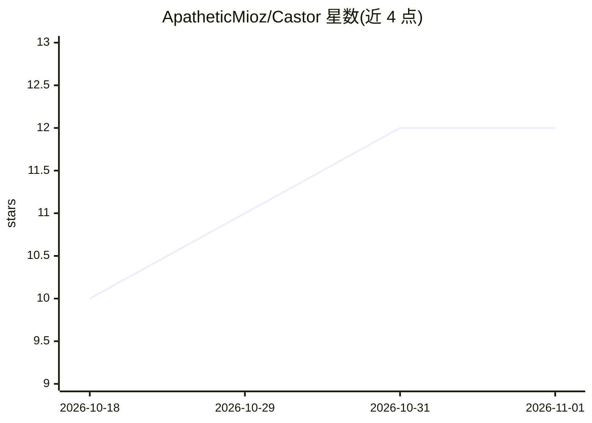

# ApatheticMioz/Castor

⭐ 12 · Rust · AGPL-3.0 · 推送 2026-10-27 · [GitHub](https://github.com/ApatheticMioz/Castor) · 个人维护

**连接云端编排与本地执行模型的 Rust MCP 微内核**

以 Rust 实现的 MCP 服务器与本地工具运行时：将 Claude Code、Antigravity 等云端编排 agent 与 Ollama、vLLM、LM Studio 等 OpenAI 兼容本地端点配对，把文件操作、AST 结构化编辑、bash 等执行工作放在本地进程内完成，云端仅做规划与审阅，工具输出不进入云端上下文。提供 3 个 stdio MCP 工具（coworker/task/server）、16 个内置沙箱工具、5 层工作区隔离，以及后台任务 OS 级等待钩子与 JSONL 遥测。通过 npx/npm 安装，AGPL-3.0 许可。

## 筛选速览

| 维度 | 判定 | 备注 |
|---|---|---|
| AI 角色 | `ai-ecosystem` | LLM/agent 周边工具 |
| 许可风险 | `viral` | AGPL-3.0 |
| 部署形态 | `library` | 以包/库形式分发 |
| 模型依赖 | local-ok | 支持本地模型 |
| 硬件要求 | — | 无带数字的原话,不猜 |
| 安装摩擦 | `low` | 无编译、无系统依赖或容器化 |
| 成熟度 | — | 结构信号不足 |

## 能力要点

- 进程内工具分发（文件/AST/bash 等 16 个内置工具）
- 5 层沙箱工作区隔离与 137 向量遏制回归测试
- 后台任务 OS 级等待钩子，云端 $0 token 阻塞等待
- llama.cpp 引导的本地推理引擎监督（start/stop/健康探测）

## 适用场景

- 让云端编码 agent 的执行环节跑在本地模型上以降低 token 成本
- 为 MCP 客户端挂接沙箱化的本地文件/AST/git 工具运行时
- 本地端点的结构化代码检索与替换（ast-grep）

## 场景标签

`Agent 框架` · 领域:Agent 开发

## 证据(README 行号)

> L7:  Pair cloud orchestrators (Claude Code, Google Antigravity) with local execution models (Ollama, vLLM, LM Studio) at
> L118: Castor registers three stdio tools across any MCP client:

## 星数曲线

2026-10-18 10 → 2026-11-01 12（+2）

---
*卡片 v1 · prompt 1.4 · 生成 2026-11-01 · 置信度 high · 依据 README sha `1e2ed9d12851` · [字段定义](../../DATASET.md)*
