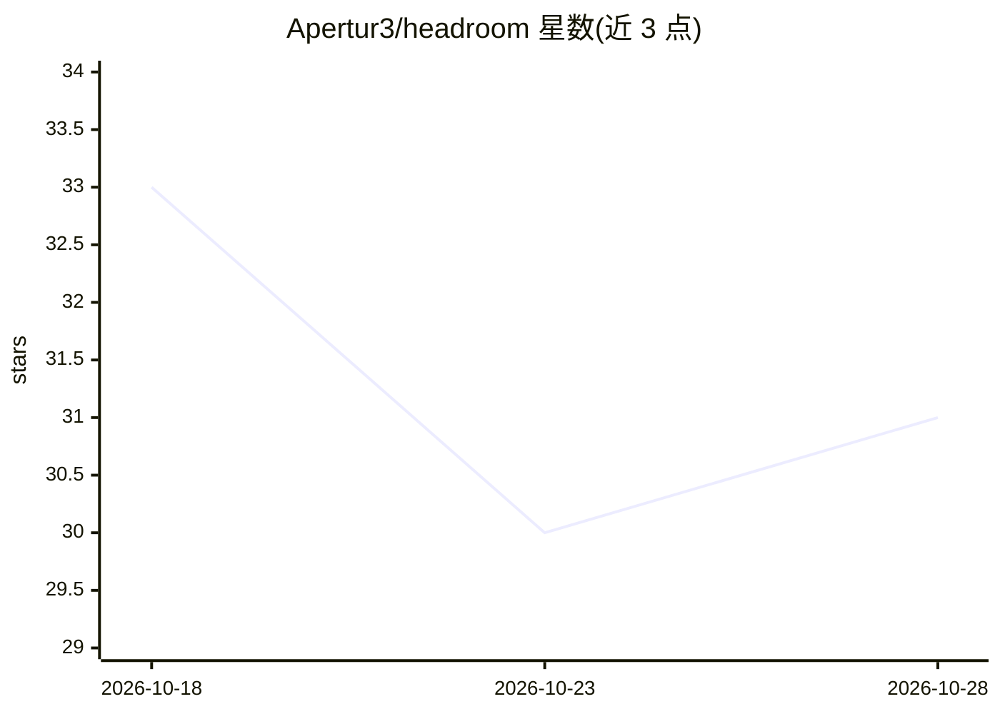

# Apertur3/headroom

⭐ 31 · TypeScript · NOASSERTION · 推送 2026-10-23 · [GitHub](https://github.com/Apertur3/headroom) · [官网](https://github.com/Apertur3/headroom#readme) · 组织维护

**AI 编程代理的配额监测守护进程：读订阅限额，答 go/wait/reroute**

面向使用 Claude、Codex、Kimi 等订阅服务的 AI 编程代理用户：本地守护进程 headroomd 读取各服务报告的 5 小时与每周限额，通过 CLI 或 MCP 回答 can/gate/route 决策，支持容量预留与租约，读取过期时输出 UNKNOWN 而非数字。可读取 Claude、Codex、Kimi、Antigravity、Grok 及本地 vLLM/llama.cpp 池。macOS 为主平台，Windows 为实验性；依赖厂商私有端点，Antigravity 与 Grok 支持为实验性。

## 筛选速览

| 维度 | 判定 | 备注 |
|---|---|---|
| AI 角色 | `ai-ecosystem` | LLM/agent 周边工具 |
| 许可风险 | `none` | NOASSERTION |
| 部署形态 | `desktop` | 安装包/桌面程序 |
| 模型依赖 | local-ok | 支持本地模型 |
| 硬件要求 | — | 无带数字的原话,不猜 |
| 安装摩擦 | `low` | 无编译、无系统依赖或容器化 |
| 成熟度 | `idea` | |

## 能力要点

- 读取 5 个订阅服务与 vLLM/llama.cpp 两类本地池的配额
- can/gate/route 决策、容量预留与租约机制，支持协作式调度
- CLI 与 MCP 双通道，提供 Claude Code 插件
- 读取过期或失败时输出 UNKNOWN，不伪造数字；零遥测

## 适用场景

- 代理派发任务前先检查订阅账户剩余配额
- 多代理并发作业时预留容量避免超限
- 限额不足时按回退清单切换到其他账户或本地池

## 场景标签

`模型网关` · 领域:Agent 开发

## 证据(README 行号)

> L5: headroomd reads the 5-hour and weekly limits your subscriptions report and answers go, wait or reroute, over the CLI
> L168: |Works with|Claude Code through MCP (registered with `claude mcp add`, covered by `mcp-registration.test.ts` and `
> L180: One daemon reads quota across Claude, Codex, Antigravity, Grok, Kimi, and local vLLM or llama.cpp

## 星数曲线

2026-10-18 33 → 2026-10-28 31（-2）

---
*卡片 v1 · prompt 1.4 · 生成 2026-10-26 · 置信度 high · 依据 README sha `845199c917fe` · [字段定义](../../DATASET.md)*
