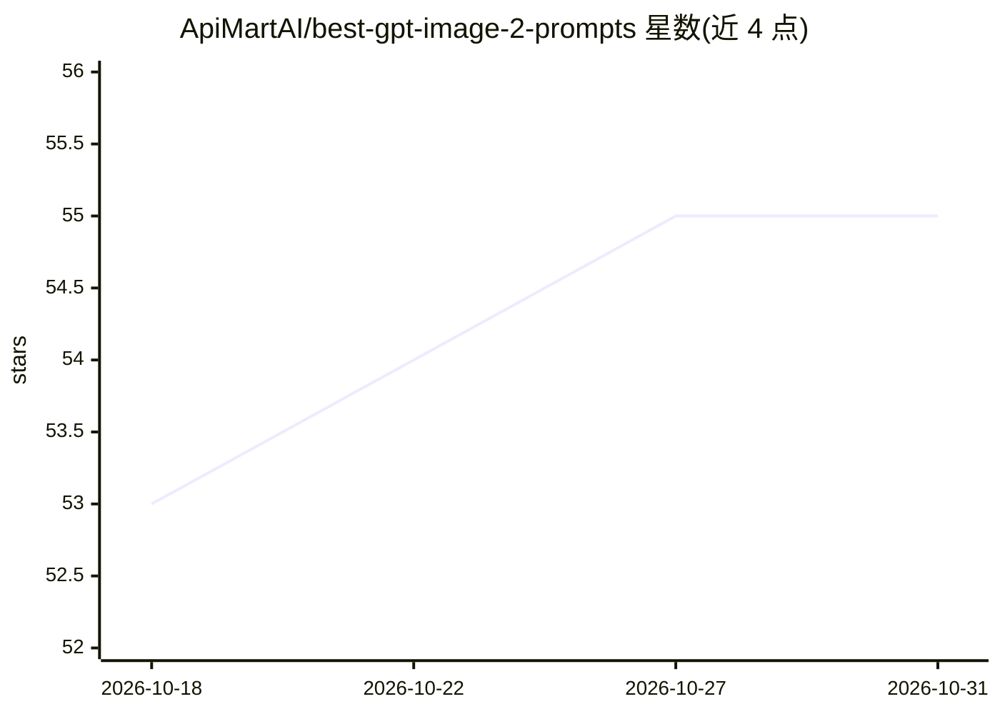

# ApiMartAI/best-gpt-image-2-prompts

⭐ 55 · Python · NOASSERTION · 推送 2026-04-22 · [GitHub](https://github.com/ApiMartAI/best-gpt-image-2-prompts) · [官网](https://apimart.ai) · 组织维护 · 中文 README

**GPT-Image-2 提示词策展画廊（107 例，5 类）**

由 APIMart 维护的图库式提示词集合：收录 107 个 GPT-Image-2 提示词案例，按人像摄影、海报插画等 5 个类别组织，每条标注原作者；内容改编自社区收集（waytoagi 飞书文档），条目保留原作者署名。用户浏览缩略图后可点击跳转至 APIMart 平台用同一提示词直接生成图像，README 提供英语、中文等 11 种语言版本，许可证为 CC BY 4.0。本仓库为静态策展内容，不含代码安装或运行步骤。

## 筛选速览

| 维度 | 判定 | 备注 |
|---|---|---|
| AI 角色 | `ai-knowledge` | 知识聚合/清单类 |
| 许可风险 | `none` | NOASSERTION |
| 部署形态 | `None` |  |
| 模型依赖 | — | README 未给出锁定关系 |
| 硬件要求 | — | 无带数字的原话,不猜 |
| 安装摩擦 | `low` | 无编译、无系统依赖或容器化 |
| 成熟度 | — | 结构信号不足 |

## 能力要点

- 107 个策展提示词案例，按 5 个类别组织
- 每条提示词标注原作者，内容改编自社区收集
- 缩略图点击跳转 APIMart 平台直接生成
- README 提供 11 种语言版本，CC BY 4.0 许可

## 适用场景

- 浏览现成提示词找想要的图像风格
- 复制案例提示词到图像生成服务使用
- 学习人像/海报类提示词的写法

## 场景标签

`提示工程` `精选清单` · 领域:Agent 开发

## 证据(README 行号)

> L24: **A curated gallery of high-quality GPT-Image-2 prompts.**
> L41: - **April 22, 2026:** Initial gallery-first layout with 107 curated cases across 5 categories.
> L33: > Powered by **APIMart** — Unified access to the world's top AI models — at up to 70% off official pricing.

## 星数曲线

2026-10-18 53 → 2026-10-31 55（+2）

---
*卡片 v1 · prompt 1.4 · 生成 2026-10-24 · 置信度 high · 依据 README sha `273fc1fc75ba` · [字段定义](../../DATASET.md)*
