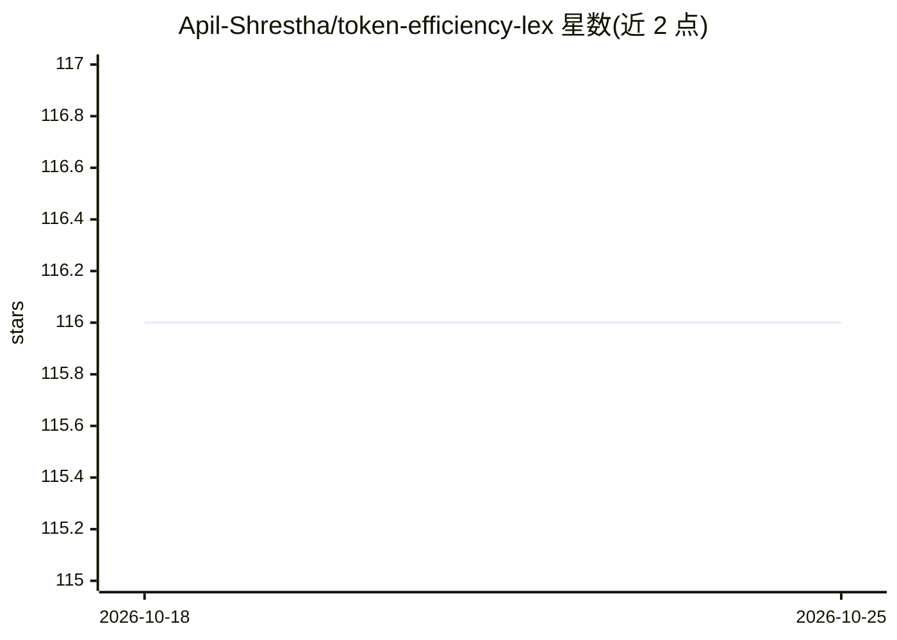

# Apil-Shrestha/token-efficiency-lex

⭐ 116 · HTML · 推送 2026-10-24 · [GitHub](https://github.com/Apil-Shrestha/token-efficiency-lex) · 个人维护

**量化 14 种语言表达同一语义所需 token 差异的基准与计算工具**

EchoLingua 是一个开源的多语言 token 效率基准框架：基于 10,000+ 人工校验的平行句对语料（新闻、文学、技术文档、对话转写，覆盖 14 种语言），通过 BERT 跨语言句向量对齐后，用多个参考 tokenizer（OpenAI、Claude、Llama、Gemini、Mistral、Cohere 等）计数 token，归一化为以英语为 1.0 基线的 Language Parity Index（LPI），并附 95% 置信区间。提供客户端纯网页面板（免服务器）与 Python 分析脚本（依赖 tiktoken、sentencepiece 等）。面向多语言 LLM 应用开发者、tokenizer 研究者与本地化团队，用于 token 预算估算、tokenizer 公平性评测与提示工程优化。

## 筛选速览

| 维度 | 判定 | 备注 |
|---|---|---|
| AI 角色 | `ai-ecosystem` | LLM/agent 周边工具 |
| 许可风险 | `none` | — |
| 部署形态 | `None` |  |
| 模型依赖 | — | README 未给出锁定关系 |
| 硬件要求 | — | 无带数字的原话,不猜 |
| 安装摩擦 | `low` | 无编译、无系统依赖或容器化 |
| 成熟度 | — | 结构信号不足 |

## 能力要点

- 10,000+ 人工校验平行句对，覆盖 14 种语言的 Language Parity Index 计算
- 插件式 tokenizer 适配器，支持 OpenAI/Claude/Gemini/Llama/Mistral/Cohere 等 tokenizer 对比
- 跨 tokenizer 版本（GPT-3.5 vs GPT-4o、Llama 2 vs Llama 3）的历史趋势分析
- 客户端纯网页面板，无需服务器即可浏览与导出对比数据（CSV/JSON）

## 适用场景

- 多语言聊天机器人或翻译服务上线前估算各语言的 token 消耗预算
- 评测自家 tokenizer 对低资源语言是否系统性不利，指导词表优化
- 多语言 API 产品按语言差异化定价或调整 token 配额

## 场景标签

`模型评测` · 领域:评测与运维

## 证据(README 行号)

> L5: **A living benchmark that measures how efficiently different languages convey the same semantic payload, revealing t
> L31: Input parallel sentences or paragraphs in two or more languages. EchoLingua tokenizes them using the reference LLM 
> L37: A manually verified corpus of 10,000+ parallel sentence pairs across 14 languages:

## 星数曲线

2026-10-18 116 → 2026-10-25 116（+0）

---
*卡片 v1 · prompt 1.4 · 生成 2026-10-23 · 置信度 high · 依据 README sha `cc41cb86aafe` · [字段定义](../../DATASET.md)*
