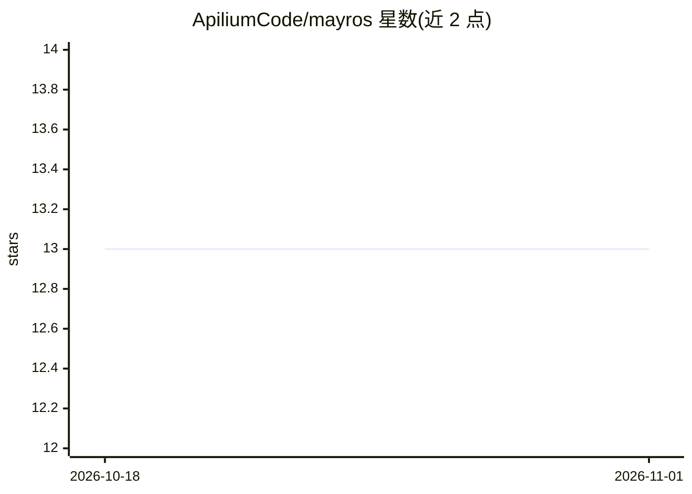

# ApiliumCode/mayros

⭐ 13 · TypeScript · MIT · 推送 2026-07-16 · [GitHub](https://github.com/ApiliumCode/mayros) · [官网](https://apilium.com/en/products/mayros) · 组织维护

**开源 AI agent 平台：多渠道助手、语义记忆与本地模型运行**

运行在用户自有设备上的开源 AI agent 框架，以 npm 包与桌面安装包分发。提供交互式编码 CLI（mayros code）、17+ 消息渠道接入（WhatsApp/Telegram/Slack 等）、基于 RDF 三元组的语义知识图谱 AIngle Cortex（跨会话持久记忆）、MCP server/client（供 Claude Desktop、Claude Code 等 MCP 客户端调用 45+ 工具）、多 agent 团队与本地模型运行（支持 Ollama/vLLM/NVIDIA NIM 运行时，含 GPU 检测与 50+ 模型目录）。运行要求 Node ≥22，安装包已捆绑 Node 与 Cortex。

## 筛选速览

| 维度 | 判定 | 备注 |
|---|---|---|
| AI 角色 | `ai-ecosystem` | LLM/agent 周边工具 |
| 许可风险 | `permissive` | MIT |
| 部署形态 | `desktop` | 安装包/桌面程序 |
| 模型依赖 | local-ok | 支持本地模型 |
| 硬件要求 | — | 无带数字的原话,不猜 |
| 安装摩擦 | `low` | 无编译、无系统依赖或容器化 |
| 成熟度 | — | 结构信号不足 |

## 能力要点

- RDF 三元组知识图谱 AIngle Cortex 提供跨会话持久语义记忆
- MCP server 暴露 45+ 工具，可被 Claude Desktop/Claude Code 等 MCP 客户端调用
- 17+ 消息渠道接入与多 agent 团队、工作流机制
- 本地模型运行：GPU 自动检测、50+ 模型目录、Ollama/vLLM/NVIDIA NIM 运行时

## 适用场景

- 在终端用 mayros code 进行 agent 驱动的编码工作流
- 让一个助手同时接入 WhatsApp、Telegram、Slack 等日常渠道
- 为 Claude Desktop/Claude Code 等 MCP 客户端补充持久语义记忆
- 在自有设备上运行本地模型并管理多 agent 任务

## 场景标签

`Agent 框架` `多智能体` `编码 Agent` `Agent 记忆` · 领域:Agent 开发

## 证据(README 行号)

> L24: **Mayros** is an open-source AI agent framework that runs on your own devices. It ships with an interactive **codin
> L219: ## MCP Server
> L262: AI coding CLIs have no memory between sessions. Mayros + AIngle Cortex fill that gap: semantic knowledge graph, DA

## 星数曲线

2026-10-18 13 → 2026-11-01 13（+0）

---
*卡片 v1 · prompt 1.4 · 生成 2026-10-31 · 置信度 high · 依据 README sha `4aa7dae1e363` · [字段定义](../../DATASET.md)*
