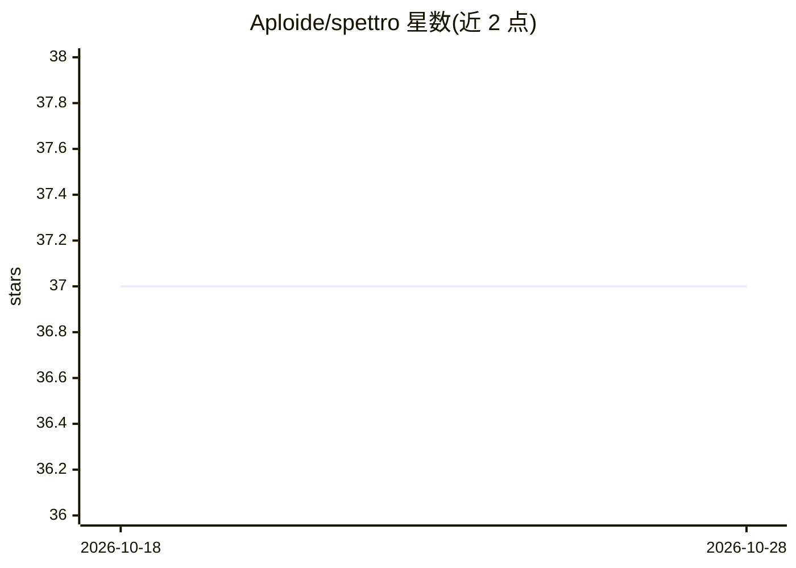

# Aploide/spettro

⭐ 37 · Go · GPL-3.0 · 推送 2026-10-21 · [GitHub](https://github.com/Aploide/spettro) · [官网](https://spettro.app) · 个人维护

**终端多 agent 编程助手，连接本地/远端模型自动规划编码测试**

Go 编写、基于 Bubble Tea TUI 的终端多 agent 编程助手。通过 spettro.agents.toml 与 agents/*.md 提示词配置 plan/coding/review/git 等角色，可并行派生子 agent，内置 bash、file-edit、grep 等工具。通过 /connect 接入 API key 或本地端点，支持 OpenAI、Anthropic 及 OpenAI 兼容端点，按 models.dev 目录选模型。提供会话持久化、权限策略（ask-first/restricted/yolo）、ACP 编辑器集成（如 Zed）与 Telegram 中继，另有订阅服务文档。安装提供 curl/PowerShell 脚本与源码编译两种方式。

## 筛选速览

| 维度 | 判定 | 备注 |
|---|---|---|
| AI 角色 | `ai-native` | 本体是模型或模型工具 |
| 许可风险 | `viral` | GPL-3.0 |
| 部署形态 | `None` |  |
| 模型依赖 | locked-api |  |
| 硬件要求 | — | 无带数字的原话,不猜 |
| 安装摩擦 | `low` | 无编译、无系统依赖或容器化 |
| 成熟度 | — | 结构信号不足 |

## 能力要点

- spettro.agents.toml + agents/*.md 配置多角色 agent（plan/coding/review 等）
- 并行子 agent 派生与 ultracode 动态工作流（分阶段、检查点、可恢复）
- 支持 OpenAI、Anthropic 与 OpenAI 兼容端点，跨 provider 归一化思考等级
- ACP 编辑器集成、Telegram 中继与 HTTP/SSE 远程控制面

## 适用场景

- 在终端里让多 agent 完成规划、编码与测试的完整流程
- 通过本地端点或各家 API key 使用自有模型选择进行编码辅助
- 从 Zed 等 ACP 编辑器或 Telegram 远程驱动编程 agent

## 场景标签

`编码 Agent` `多智能体` · 领域:Agent 开发

## 证据(README 行号)

> L9: Spettro is a terminal-first multi-agent coding assistant written in Go.
> L46: - Fantasy-backed provider routing for OpenAI, Anthropic, and OpenAI-compatible text calls

## 星数曲线

2026-10-18 37 → 2026-10-28 37（+0）

---
*卡片 v1 · prompt 1.4 · 生成 2026-10-25 · 置信度 high · 依据 README sha `3c696c133b2a` · [字段定义](../../DATASET.md)*
