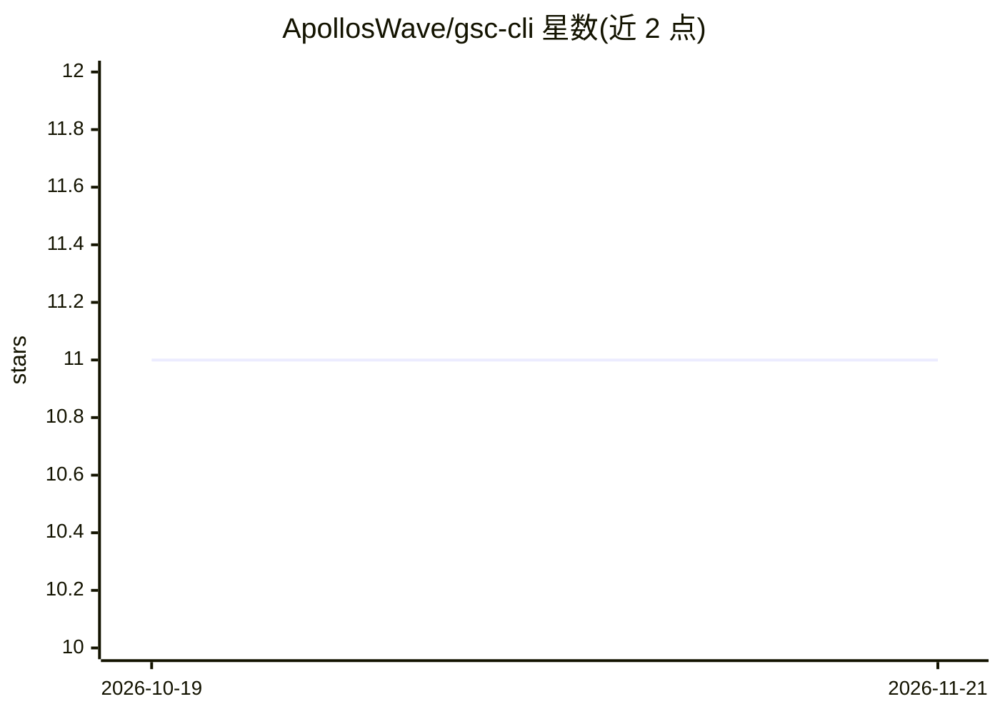

# ApollosWave/gsc-cli

⭐ 11 · Ruby · MIT · 推送 2026-09-23 · [GitHub](https://github.com/ApollosWave/gsc-cli) · [官网](https://rubygems.org/gems/gsc-cli) · 个人维护

**面向开发者与技术 SEO 的 Google Search Console 命令行工具**

纯 Ruby 标准库实现的 CLI 工具，零 gem 依赖，直接调用 Google 的 HTTP API 读取 Search Console 一手数据。提供索引管理、软 404 诊断与修复、站点审计、Core Web Vitals 审计、关键词扩展、AI Overview 检测与引用模拟等功能；每条命令支持 --json/--compact/--ndjson 输出以供 AI 编码代理程序化消费；本地执行，无遥测，无需外部 LLM API key。通过 RubyGems 或独立安装脚本安装，支持 Ruby 3.0–3.4。

## 筛选速览

| 维度 | 判定 | 备注 |
|---|---|---|
| AI 角色 | `ai-enhanced` | 去掉 AI 部分产品仍成立 |
| 许可风险 | `permissive` | MIT |
| 部署形态 | `None` |  |
| 模型依赖 | — | README 未给出锁定关系 |
| 硬件要求 | — | 无带数字的原话,不猜 |
| 安装摩擦 | `low` | 无编译、无系统依赖或容器化 |
| 成熟度 | — | 结构信号不足 |

## 能力要点

- 零 gem 依赖，纯 Ruby 标准库（Net::HTTP、OpenSSL、JSON）实现
- 每条命令支持 --json/--compact/--ndjson，面向 AI agent 程序化消费
- AES-256-GCM 本地凭据库管理多域名服务账号
- 软 404 诊断并生成 14 种服务器栈的重定向配置块

## 适用场景

- 批量检查站点 URL 的索引状态并触发 Googlebot 重新索引
- 审计 Core Web Vitals 与死链、图片 alt 缺失等技术 SEO 问题
- 检测 Google AI Overview 引用缺口并生成片段捕获方案
- 为多客户代理管理 50+ 服务账号凭据的本地加密切换

## 场景标签

 · 领域:技术 SEO/开发者工具

## 证据(README 行号)

> L34: 5. **AI Coding Agents Cannot Click Web Buttons**: Modern coding agents (Antigravity, Claude Code, Cursor, Cline) re
> L80: - 🤖 **AI Agent Native**: Every single command supports `--compact`, `--ndjson`, and `--json` for instantaneous prog

## 星数曲线

2026-10-19 11 → 2026-11-21 11（+0）

---
*卡片 v1 · prompt 1.4 · 生成 2026-11-19 · 置信度 high · 依据 README sha `02399bd00c97` · [字段定义](../../DATASET.md)*
