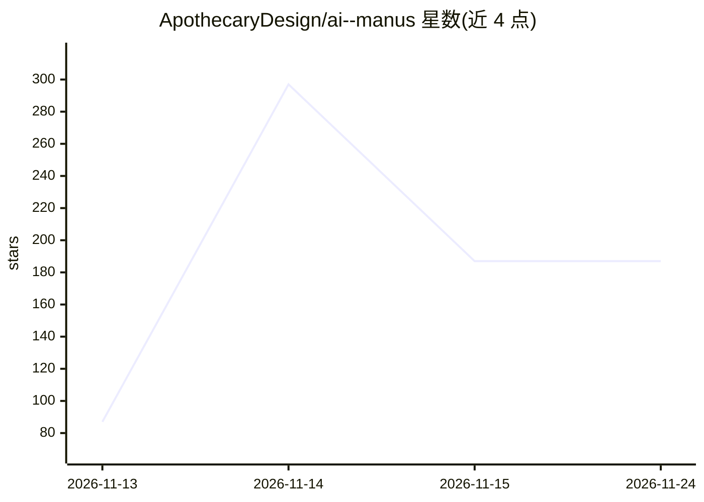

# ApothecaryDesign/ai--manus

⭐ 187 · Apache-2.0 · 推送 2026-11-15 · [GitHub](https://github.com/ApothecaryDesign/ai--manus) · 个人维护

**自主 AI Agent：代用户执行代码与控制浏览器完成多步任务**

面向终端用户的自主 AI 代理：接受自然语言指令后自行编写并执行脚本、操作浏览器（导航页面、填写表单、抓取信息），完成多步任务，定位为家庭、学习与轻量办公场景的个人助手，而非企业平台。README 未给出具体安装命令、模型接入方式或代码仓库结构，仅描述功能、兼容性表（最低 4 GB 内存/双核 CPU）与使用流程。功能声明均以营销性描述呈现，缺少可验证的技术细节。

## 筛选速览

| 维度 | 判定 | 备注 |
|---|---|---|
| AI 角色 | `ai-native` | 本体是模型或模型工具 |
| 许可风险 | `permissive` | Apache-2.0 |
| 部署形态 | `None` |  |
| 模型依赖 | — | README 未给出锁定关系 |
| 硬件要求 | — | 无带数字的原话,不猜 |
| 安装摩擦 | `low` | 无编译、无系统依赖或容器化 |
| 成熟度 | — | 结构信号不足 |

## 能力要点

- 自主执行代码与脚本
- 浏览器控制：导航、填表、采集信息
- 代码与浏览器动作在同一任务流中衔接
- 面向小规模日常任务的后台个人助手

## 适用场景

- 让代理代为完成查网页、填表单等重复性操作
- 组织研究笔记、跑小型脚本
- 多页面信息汇总用于轻量报告

## 场景标签

`AI 助手` `浏览器自动化` · 领域:效率与自动化

## 证据(README 行号)

> L10: - **Autonomous Code Execution:** Manus AI agent runs code on its own to complete tasks, so you can focus on decisio
> L18: Manus is an autonomous AI agent designed to run code and control a browser on your behalf. Instead of acting like a

## 星数曲线

2026-11-13 87 → 2026-11-24 187（+100）

---
*卡片 v1 · prompt 1.4 · 生成 2026-11-17 · 置信度 low · 依据 README sha `0f78ee3a5dd2` · [字段定义](../../DATASET.md)*
