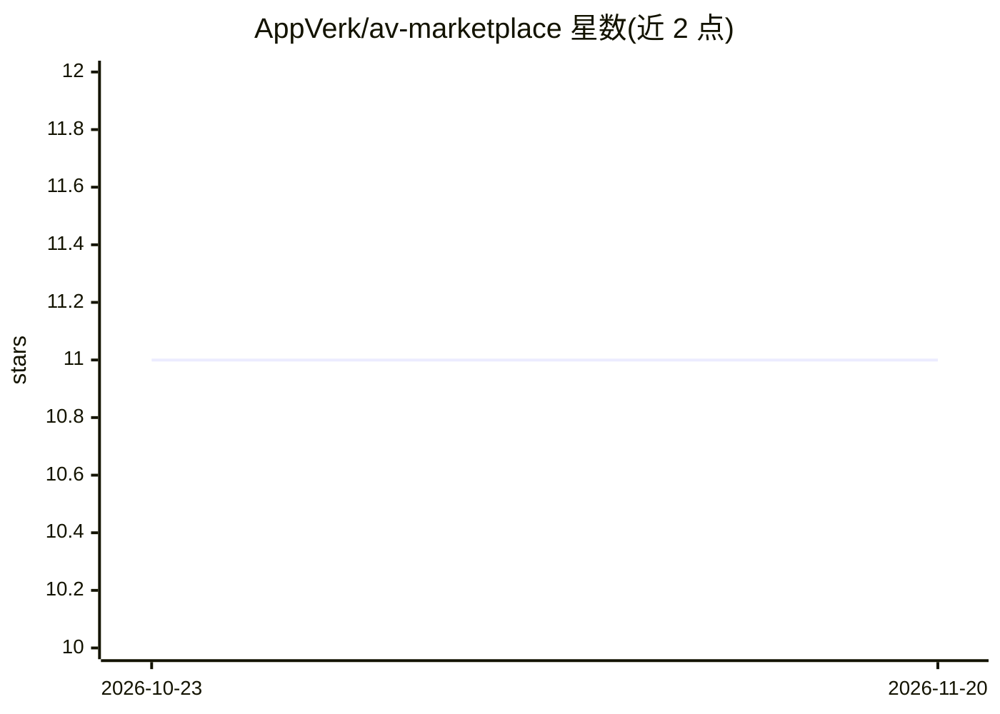

# AppVerk/av-marketplace

⭐ 11 · Python · MIT · 推送 2026-11-17 · [GitHub](https://github.com/AppVerk/av-marketplace) · 组织维护

**为 Claude Code 与 Oh My Pi 提供的插件化开发流程 harness**

一组以 marketplace 形式安装的插件集，覆盖从计划到提交的流程：计划模式或经规格评审产出计划，用户批准后进入 Delivery 流水线，按任务路由到拥有对应文件的 Python、TypeScript+React、PHP developer agent，实现并经过最多 3 轮修复审查后提交；每个任务由 task reviewer 检查，代码评审含 challenger 反证与跨域交叉验证，QA 插件在浏览器、API、数据存储与桌面应用中测试运行中的程序，发现项带 ID（SEC-001/QA-001）可逐条或批量修复，Commit 插件执行 Conventional Commits 并阻止直接 git commit 与 force-push。

## 筛选速览

| 维度 | 判定 | 备注 |
|---|---|---|
| AI 角色 | `ai-ecosystem` | LLM/agent 周边工具 |
| 许可风险 | `permissive` | MIT |
| 部署形态 | `None` |  |
| 模型依赖 | — | README 未给出锁定关系 |
| 硬件要求 | — | 无带数字的原话,不猜 |
| 安装摩擦 | `low` | 无编译、无系统依赖或容器化 |
| 成熟度 | — | 结构信号不足 |

## 能力要点

- 同一 Delivery 流水线同时支持 Claude Code 与 Oh My Pi 两种宿主
- 代码评审含 adversarial challenger 与跨域交叉验证，发现项带可引用 ID
- QA 插件在浏览器/API/数据存储/桌面应用中测试运行中的程序并可批准后修复复测
- Commit 插件阻止直接 git commit、force-push 与受保护分支删除

## 适用场景

- 把已批准的计划按任务分派给各技术栈 agent 逐步交付
- 在提交前对代码变更做多模型交叉评审
- 对改动做浏览器与 API 层面的自动化 QA 并按 ID 修复

## 场景标签

`多智能体` `代码审查` `编码 Agent` · 领域:Agent 开发

## 证据(README 行号)

> L3: **One AI development harness for Claude Code and Oh My Pi.**
> L24: Claude Code and Oh My Pi hand the plan to the same Delivery pipeline. They differ in how the plan is made and check
> L44: Add the marketplace, then install the plugins you need. Available Plugins lists their IDs and which tool supports e

## 星数曲线

2026-10-23 11 → 2026-11-20 11（+0）

---
*卡片 v1 · prompt 1.4 · 生成 2026-11-19 · 置信度 high · 依据 README sha `5712696df159` · [字段定义](../../DATASET.md)*
