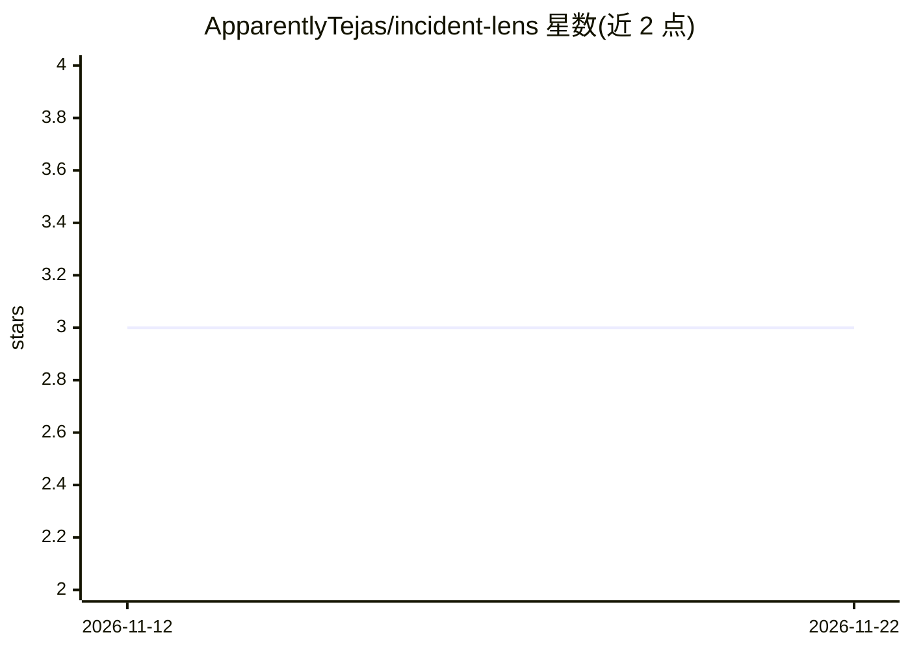

# ApparentlyTejas/incident-lens

⭐ 3 · Python · NOASSERTION · 推送 2026-11-07 · [GitHub](https://github.com/ApparentlyTejas/incident-lens) · 个人维护

**给 Claude 提供角色化日志分析 MCP 工具的服务器**

面向黑客松任务「Making Sense of Logs」构建的 MCP 服务器，为 Claude Desktop/Code 提供 13 个工具，对 SereneDB 中的 BGL、OpenStack、Zookeeper 日志做检索、计数、趋势与集中度分析；按工程师/组长/经理三种角色组织 MCP prompts 与四段式回答契约（Observed/Hypotheses/Checks/Unknown）。每次工具调用记录 SQL、参数与计数到 SQLite 哈希链账本，返回 evidence_id，可重放并校验完整性。查询走只读数据库角色、参数化 SQL、默认 20 行/上限 100 行、30 秒超时。需 Python 3.10+，并自启动 SereneDB（Linux x86_64 原生，其他平台走 Docker）。

## 筛选速览

| 维度 | 判定 | 备注 |
|---|---|---|
| AI 角色 | `ai-ecosystem` | LLM/agent 周边工具 |
| 许可风险 | `none` | NOASSERTION |
| 部署形态 | `library` | 以包/库形式分发 |
| 模型依赖 | locked-api |  |
| 硬件要求 | — | 无带数字的原话,不猜 |
| 安装摩擦 | `low` | 无编译、无系统依赖或容器化 |
| 成熟度 | — | 结构信号不足 |

## 能力要点

- 13 个 MCP 工具按三种角色分配，覆盖检索、计数、趋势、episode 折叠与集中度排序
- 哈希链 evidence ledger 记录每次调用的 SQL 与结果，支持重放与篡改检测
- 条目 vs 事件折叠机制与按集中度（而非频率）排序的异常检测
- 附带 Web 控制台与 CLI，通过 Anthropic API 调用同一组工具

## 适用场景

- 让 Claude 按工程师/组长/经理视角分析大规模系统日志
- 对日志分析结论提供可重放的 SQL 证据与防篡改账本
- 在 OpenStack/BGL 语料上定位集中出现的故障模式

## 场景标签

`LLM 可观测性` · 领域:评测与运维

## 证据(README 行号)

> L9: **An MCP server that gives Claude role-aware, evidence-backed tools over the BGL, OpenStack and Zookeeper logs in Se
> L38:   C[Claude Desktop / Claude Code] -- MCP --> S[Incident Lens MCP server]
> L79: claude mcp add incident-lens -- python3 /ABS/PATH/incident-lens/run_server.py

## 星数曲线

2026-11-12 3 → 2026-11-22 3（+0）

---
*卡片 v1 · prompt 1.4 · 生成 2026-11-22 · 置信度 mid · 依据 README sha `83df3ed67577` · [字段定义](../../DATASET.md)*
