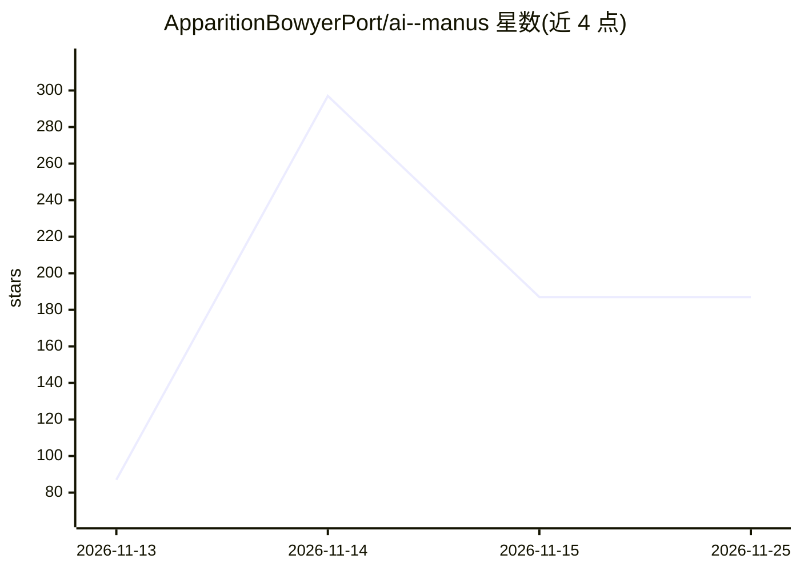

# ApparitionBowyerPort/ai--manus

⭐ 187 · Apache-2.0 · 推送 2026-11-15 · [GitHub](https://github.com/ApparitionBowyerPort/ai--manus) · 个人维护

**面向日常任务的自主 AI Agent：自动执行代码与浏览器操作**

Manus 是一个自主 AI Agent 系统，在沙箱环境中运行各类工具与操作：自主编写并执行脚本、控制浏览器（导航网页、填写表单、收集信息）、执行多步骤任务。README 定位于家庭、学习与轻量办公场景，而非企业平台。给出兼容性表（最低双核 CPU、4 GB 内存，推荐多核与 8 GB 以上）与六步上手流程。README 未提供具体安装命令、下载渠道细节或所依赖的模型/SDK 技术说明。

## 筛选速览

| 维度 | 判定 | 备注 |
|---|---|---|
| AI 角色 | `ai-native` | 本体是模型或模型工具 |
| 许可风险 | `permissive` | Apache-2.0 |
| 部署形态 | `None` |  |
| 模型依赖 | — | README 未给出锁定关系 |
| 硬件要求 | — | 无带数字的原话,不猜 |
| 安装摩擦 | `low` | 无编译、无系统依赖或容器化 |
| 成熟度 | — | 结构信号不足 |

## 能力要点

- 自主编写并执行代码以完成任务
- 浏览器控制：导航、填表、信息收集
- 多步骤任务，脚本与浏览器操作可在同一流程中衔接
- 面向家庭/学习/轻量办公的小规模场景

## 适用场景

- 让 agent 代为浏览网页、填表和收集资料
- 自动执行小脚本与日常重复性任务
- 整理研究笔记与多页信息汇总

## 场景标签

`浏览器自动化` `编码 Agent` · 领域:效率与自动化

## 证据(README 行号)

> L10: - **Autonomous Code Execution:** Manus AI agent runs code on its own to complete tasks, so you can focus on decisio
> L18: Manus is an autonomous AI agent designed to run code and control a browser on your behalf. Instead of acting like a

## 星数曲线

2026-11-13 87 → 2026-11-25 187（+100）

---
*卡片 v1 · prompt 1.4 · 生成 2026-11-17 · 置信度 mid · 依据 README sha `a3d88e202bf0` · [字段定义](../../DATASET.md)*
