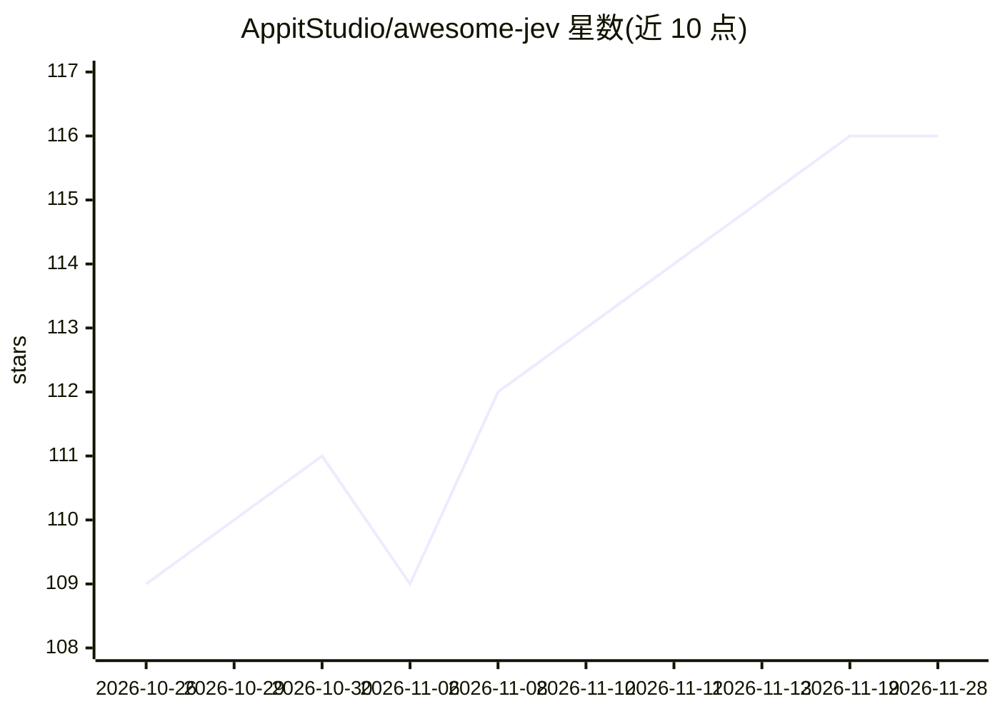

# AppitStudio/awesome-jev

⭐ 116 · Python · NOASSERTION · 推送 2026-11-27 · [GitHub](https://github.com/AppitStudio/awesome-jev) · 组织维护

**面向开发者收集 Jev 模型资源与可运行决策示例的目录**

独立社区维护的 Jev 资源目录。Jev 是 TypeSafe 的 System One 决策模型：输入状态与类型化问题，返回选项、分数与概率。目录收录使用 Jev 的应用、官方 SDK 文档（JavaScript/Python）、HTTP API 参考，以及可在本地用合成 mock 响应运行的示例工作流，无需账号或 API key。另提供 awesome-jev-guide 技能，供编码代理按自然语言描述选择并改编示例、搭建入门项目。

## 筛选速览

| 维度 | 判定 | 备注 |
|---|---|---|
| AI 角色 | `ai-knowledge` | 知识聚合/清单类 |
| 许可风险 | `none` | NOASSERTION |
| 部署形态 | `library` | 以包/库形式分发 |
| 模型依赖 | — | README 未给出锁定关系 |
| 硬件要求 | — | 无带数字的原话,不猜 |
| 安装摩擦 | `low` | 无编译、无系统依赖或容器化 |
| 成熟度 | — | 结构信号不足 |

## 能力要点

- 收录使用 Jev 的社区应用目录，附用例、安装、限制与验证范围说明
- 提供 npx skills add 安装的编码代理引导技能
- 示例支持本地合成 mock 响应运行，无需账号/API key/包安装
- 官方 SDK 覆盖 JavaScript/TypeScript 与 Python 客户端

## 适用场景

- 想了解 Jev 决策接口能构建什么应用
- 让编码代理按我的工作流选择并改编示例项目
- 本地离线试跑完整决策工作流再决定接入

## 场景标签

`精选清单` · 领域:学习与行业

## 证据(README 行号)

> L1: # Awesome Jev Awesome
> L5: Jev is TypeSafe AI's System One model: give it state and typed questions, then use the returned choices, scores, and
> L11: ## Contents

## 星数曲线

2026-10-26 109 → 2026-11-28 116（+7）

---
*卡片 v1 · prompt 1.4 · 生成 2026-11-28 · 置信度 high · 依据 README sha `69774b83927a` · [字段定义](../../DATASET.md)*
