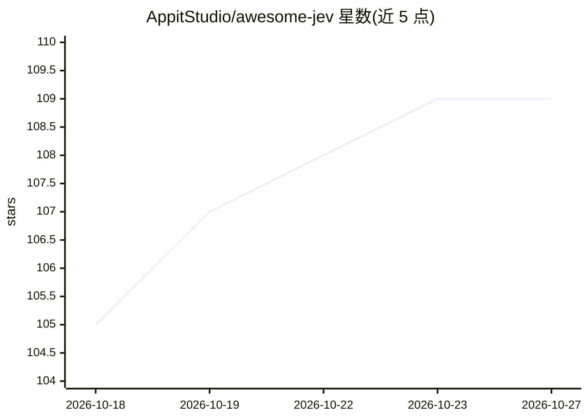

# AppitStudio/awesome-jev

⭐ 109 · Python · NOASSERTION · 推送 2026-10-26 · [GitHub](https://github.com/AppitStudio/awesome-jev) · 组织维护 · 中文 README

**Jev（TypeSafe System One）应用与开发者资源策展清单**

独立的社区 awesome 清单，收录基于 Jev 的应用、官方 SDK（JavaScript/Python）、工具与可运行的决策示例。Jev 是 TypeSafe AI 的 System One 模型：输入状态与带类型的问题，返回选择、评分与概率供代码使用。清单按应用/工具目录组织，每个项目附用例、安装、示例与验证范围说明；另提供 awesome-jev-guide agent 技能（npx 安装）供编码代理引导选型，并说明离线示例无需账号或 API key。官方资源由 TypeSafe 维护，社区条目含 BYOK 与开源许可标注。

## 筛选速览

| 维度 | 判定 | 备注 |
|---|---|---|
| AI 角色 | `ai-knowledge` | 知识聚合/清单类 |
| 许可风险 | `none` | NOASSERTION |
| 部署形态 | `desktop` | 安装包/桌面程序 |
| 模型依赖 | — | README 未给出锁定关系 |
| 硬件要求 | — | 无带数字的原话,不猜 |
| 安装摩擦 | `low` | 无编译、无系统依赖或容器化 |
| 成熟度 | — | 结构信号不足 |

## 能力要点

- 收录大量 Jev 驱动应用的目录（含用例/安装/限制说明）
- 覆盖 TypeSafe 官方 JavaScript/Python SDK 与 System One Adapter
- awesome-jev-guide 编码代理技能，用 npx skills 安装
- 离线示例无需账号、API key 或包安装即可运行

## 适用场景

- 查找基于 Jev 的应用与工具作为选型参考
- 通过 agent 技能引导选择决策模式与示例项目
- 学习 Jev 的状态+问题接口与 Choice/Score/Noul 决策原语

## 场景标签

`精选清单` · 领域:学习与行业

## 证据(README 行号)

> L1: # Awesome Jev Awesome
> L5: Jev is TypeSafe AI's System One model: give it state and typed questions, then use the returned choices, scores, and

## 星数曲线

2026-10-18 105 → 2026-10-27 109（+4）

---
*卡片 v1 · prompt 1.4 · 生成 2026-10-23 · 置信度 high · 依据 README sha `96e3e0405489` · [字段定义](../../DATASET.md)*
