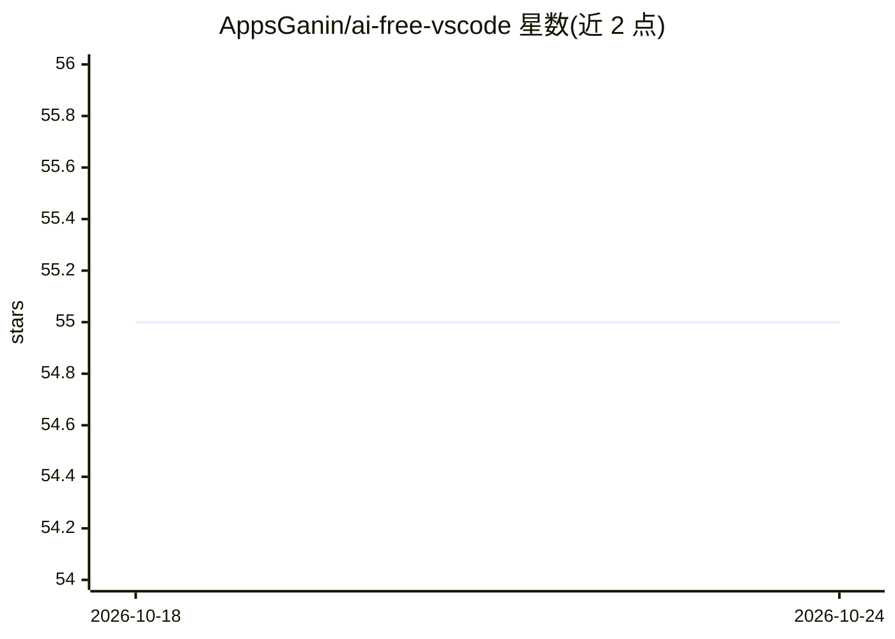

# AppsGanin/ai-free-vscode

⭐ 55 · TypeScript · MIT · 推送 2026-10-21 · [GitHub](https://github.com/AppsGanin/ai-free-vscode) · 个人维护

**让 VS Code Copilot Chat 免 API key 使用网页版免费 AI 的扩展**

VS Code 扩展，通过 Playwright 浏览器会话登录 Qwen、DeepSeek、Kimi、Z.ai 等网页版模型，将其注册为 Copilot Chat 提供方，无需 API key 与付费端点；支持流式输出、思考模式、工具调用，并提供提交信息生成、按需行内补全与 Fix with AI 快速修复。也可添加 Ollama、LM Studio 等 OpenAI 兼容端点。README 明确警告：非官方 API，账号可能被限流或封禁，供应方可能随时不可用。从 VS Code Marketplace 或 VSIX 安装。

## 筛选速览

| 维度 | 判定 | 备注 |
|---|---|---|
| AI 角色 | `ai-ecosystem` | LLM/agent 周边工具 |
| 许可风险 | `permissive` | MIT |
| 部署形态 | `desktop` | 安装包/桌面程序 |
| 模型依赖 | local-ok | 支持本地模型 |
| 硬件要求 | — | 无带数字的原话,不猜 |
| 安装摩擦 | `low` | 无编译、无系统依赖或容器化 |
| 成熟度 | — | 结构信号不足 |

## 能力要点

- 浏览器会话登录免费网页模型并注册为 Copilot Chat 提供方，无需 API key
- 提交信息生成、按需行内补全、带 diff 预览的 Fix with AI
- 可添加 Ollama/LM Studio/vLLM 等 OpenAI 兼容端点
- 针对 Qwen WAF 与 Z.ai 验证的浏览器桥接降级方案

## 适用场景

- 没有付费 API key 时在 VS Code 里用免费模型聊天或改代码
- 从暂存 diff 一键生成提交信息
- 把本地 Ollama/LM Studio 模型统一挂进 Copilot Chat 选择器

## 场景标签

`聊天机器人` `代码生成` · 领域:编码与开发

## 证据(README 行号)

> L16: **AI Free VSCode** connects free web-based models through a Playwright browser session and registers them as a Copi
> L125: 1. The extension registers a single Copilot Chat provider: `free-ai-vscode`.

## 星数曲线

2026-10-18 55 → 2026-10-24 55（+0）

---
*卡片 v1 · prompt 1.4 · 生成 2026-10-24 · 置信度 mid · 依据 README sha `80e837994900` · [字段定义](../../DATASET.md)*
