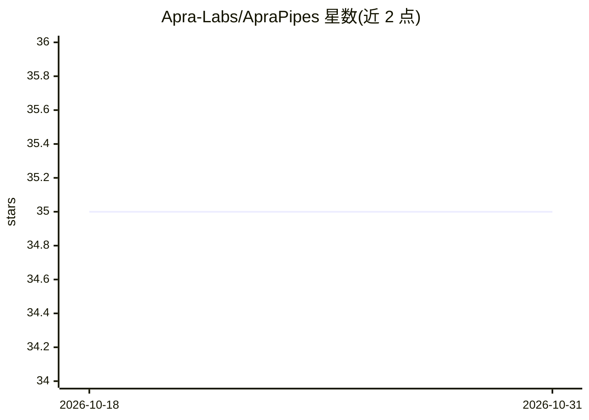

# Apra-Labs/ApraPipes

⭐ 35 · C++ · MIT · 推送 2026-10-29 · [GitHub](https://github.com/Apra-Labs/ApraPipes) · 组织维护

**面向视频/图像处理应用的 C++ 流水线框架，含 AI 推理模块**

ApraPipes 是用于开发视频与图像处理应用的流水线框架，支持多 GPU 与多种机器学习工具包。提供 50 余个注册模块（源、变换、编码器、AI 推理），可用 JSON 配置或 JavaScript 声明式构建流水线，带 GPU 加速与 CPU↔GPU 内存自动桥接、Node.js addon 与 CLI 工具。以源码方式分发，需在 Windows/Linux/macOS/Jetson 上编译（编译约需 2 小时），可选 CUDA 或无 CUDA 构建，Docker 构建镜像约 10 分钟完成。

## 筛选速览

| 维度 | 判定 | 备注 |
|---|---|---|
| AI 角色 | `ai-ecosystem` | LLM/agent 周边工具 |
| 许可风险 | `permissive` | MIT |
| 部署形态 | `desktop` | 安装包/桌面程序 |
| 模型依赖 | — | README 未给出锁定关系 |
| 硬件要求 | — | 无带数字的原话,不猜 |
| 安装摩擦 | `low` | 无编译、无系统依赖或容器化 |
| 成熟度 | — | 结构信号不足 |

## 能力要点

- 50+ 注册模块（源/变换/编码器/AI 推理）
- JSON 或 JavaScript 声明式流水线 + CLI 校验工具
- GPU 加速与 CPU↔GPU 内存自动桥接，支持多 GPU
- Windows/Linux(x64/ARM64 Jetson)/macOS/Docker 多平台 CI 构建测试

## 适用场景

- 构建视频/图像处理流水线应用
- 在 Jetson 等嵌入式板上部署带 AI 推理的视频处理
- 通过 Node.js addon 在 JavaScript/TypeScript 应用中使用流水线

## 场景标签

`图像视频处理` · 领域:感知与多模态

## 证据(README 行号)

> L4: A pipeline framework for developing video and image processing applications. Supports multiple GPUs and Machine Lear
> L19: - 50+ registered modules (sources, transforms, encoders, AI inference)

## 星数曲线

2026-10-18 35 → 2026-10-31 35（+0）

---
*卡片 v1 · prompt 1.4 · 生成 2026-10-25 · 置信度 high · 依据 README sha `c740f8e5d730` · [字段定义](../../DATASET.md)*
