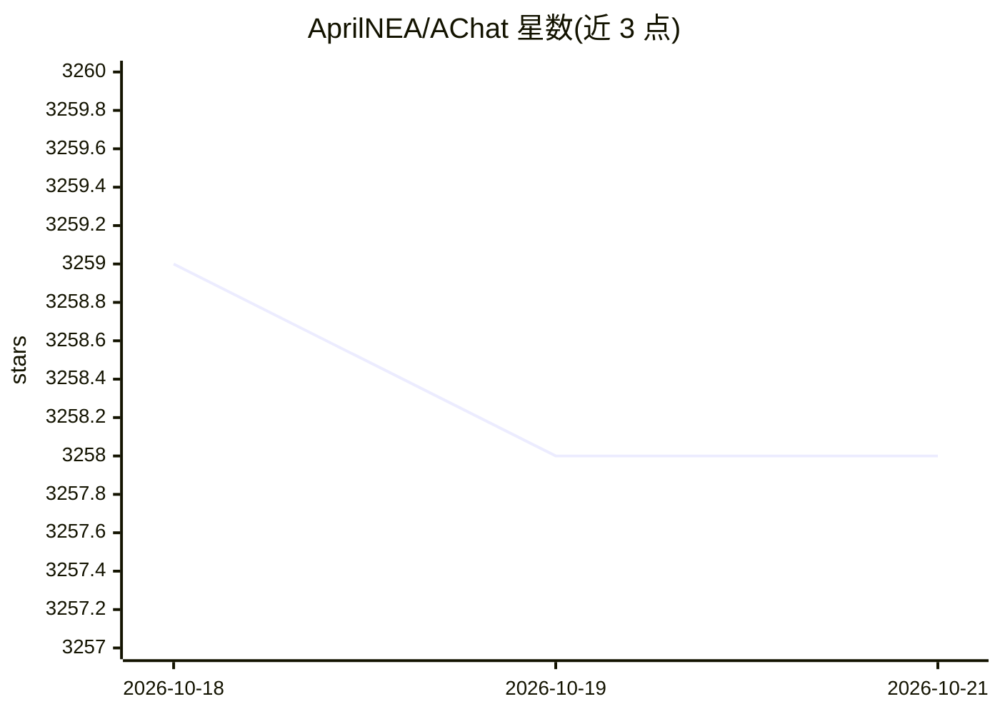

# AprilNEA/AChat

⭐ 3,258 · TypeScript · NOASSERTION · 推送 2026-04-17 · [GitHub](https://github.com/AprilNEA/AChat) · [官网](https://achat.dev) · 个人维护 · 中文 README

**面向企业与团队的自托管本地优先 AI 对话平台**

开源、可自托管、本地优先的 AI 对话平台，面向企业与团队使用。功能包括集中管理团队 AI 对话记录、对话历史检索与分类、内置商用计费/支付/成本管理工具、团队角色与权限分配、数据隐私与合规、内容审核以及插件扩展。当前主力版本 V4 处于开发中，V3/V1 停止更新、V2 已废弃；README 未给出具体安装命令，配置与安装需查阅其文档。

## 筛选速览

| 维度 | 判定 | 备注 |
|---|---|---|
| AI 角色 | `ai-native` | 本体是模型或模型工具 |
| 许可风险 | `none` | NOASSERTION |
| 部署形态 | `None` |  |
| 模型依赖 | — | README 未给出锁定关系 |
| 硬件要求 | — | 无带数字的原话,不猜 |
| 安装摩擦 | `low` | 无编译、无系统依赖或容器化 |
| 成熟度 | `idea` | |

## 能力要点

- 团队 AI 对话集中管理与历史检索分类
- 内置 AI 用量计费、支付与成本管理
- 团队角色权限与数据合规、内容审核功能
- 插件方式可扩展

## 适用场景

- 团队在自托管环境中统一使用和管理 AI 对话
- 企业对 AI 使用量计费并管控数据合规
- 对敏感内容进行审核过滤

## 场景标签

`聊天机器人` · 领域:对话与助手

## 证据(README 行号)

> L4:  An open-source/self-hosted/local-first AI platform, designed for enterprises and teams, perfectly combining powerfu
> L24: - 💬 **Centralized AI Conversation Management**

## 星数曲线

2026-10-18 3,259 → 2026-10-21 3,258（-1）

---
*卡片 v1 · prompt 1.4 · 生成 2026-10-21 · 置信度 mid · 依据 README sha `19cc4566a499` · [字段定义](../../DATASET.md)*
