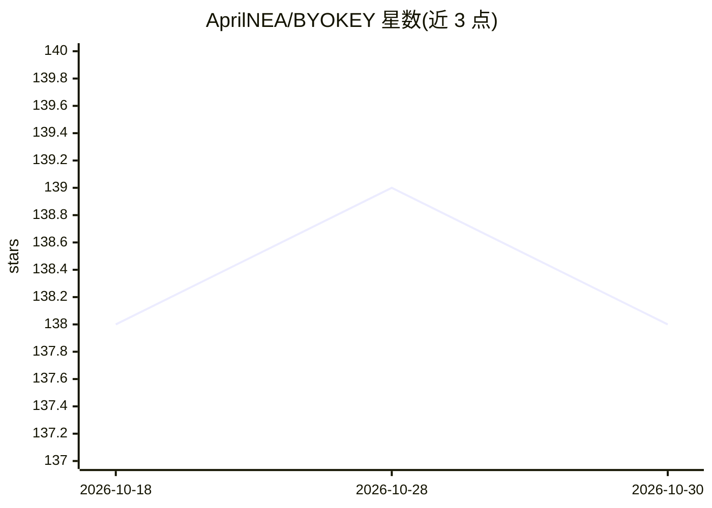

# AprilNEA/BYOKEY

⭐ 138 · Rust · NOASSERTION · 推送 2026-10-11 · [GitHub](https://github.com/AprilNEA/BYOKEY) · 个人维护 · 中文 README

**本地网关：把 AI 订阅（Copilot/Cursor/Claude 等）转为标准 API 端点**

用 Rust 编写的本地代理网关（byokey serve）：把 GitHub Copilot、Cursor、Claude Pro/Max、ChatGPT.app/Codex 等订阅接入，对外暴露 OpenAI Responses API（/v1/responses、/codex/*）与 Anthropic Messages API（/v1/messages、/v1/models），供 Claude Code、Claude Desktop 及任何兼容客户端使用。提供 OAuth 设备码/PKCE 登录与 SQLite 令牌持久化，支持 launchd/systemd/Windows SCM 服务化运行与配置热重载。限制：WebSocket 不支持；Responses/Codex 转发需从 master 源码构建，v3.0.0 发布版不含该功能。

## 筛选速览

| 维度 | 判定 | 备注 |
|---|---|---|
| AI 角色 | `ai-ecosystem` | LLM/agent 周边工具 |
| 许可风险 | `none` | NOASSERTION |
| 部署形态 | `library` | 以包/库形式分发 |
| 模型依赖 | locked-api |  |
| 硬件要求 | — | 无带数字的原话,不猜 |
| 安装摩擦 | `low` | 无编译、无系统依赖或容器化 |
| 成熟度 | — | 结构信号不足 |

## 能力要点

- Responses API 与 Anthropic Messages API 双协议本地网关
- Copilot/Cursor 作为 Claude 后端，含配额感知的账号选择
- OAuth（设备码/PKCE）登录与 ~/.byokey/tokens.db 令牌后台刷新
- byokey claude start/inject/desktop 一键接线 Claude Code/Desktop，byokey doctor 自检
- launchd/systemd/Windows SCM 服务注册与配置热重载

## 适用场景

- 用自己的 Claude/Copilot/Cursor 订阅驱动 Claude Code 或其他 API 客户端
- 把 ChatGPT 桌面端 Codex 能力接到自定义工具链
- 统一多家订阅为标准端点做本地路由与模型别名管理

## 场景标签

`模型网关` · 领域:Agent 开发

## 证据(README 行号)

> L6: Run ChatGPT.app / Codex and Claude clients through a local gateway.
> L57: Cursor         ─┼──  byokey serve  ──────────┼──  Claude Desktop
> L63: - **Responses API** — `/v1/responses` and `/codex/responses` for ChatGPT.app / Codex, with model aliases, custom up

## 星数曲线

2026-10-18 138 → 2026-10-30 138（+0）

---
*卡片 v1 · prompt 1.4 · 生成 2026-10-22 · 置信度 high · 依据 README sha `9cae7b8de1f6` · [字段定义](../../DATASET.md)*
