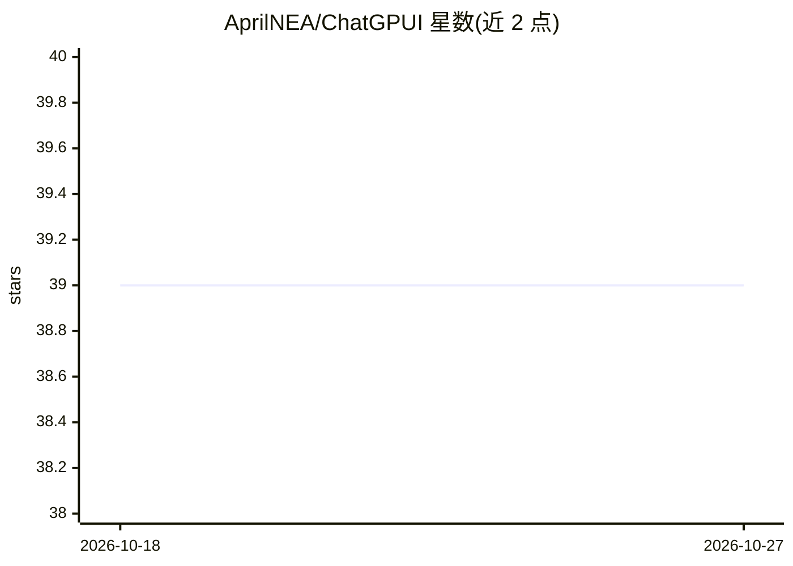

# AprilNEA/ChatGPUI

⭐ 39 · Rust · NOASSERTION · 推送 2026-06-25 · [GitHub](https://github.com/AprilNEA/ChatGPUI) · 个人维护

**基于 GPUI 的 GPU 加速原生 LLM 聊天客户端**

用 Rust 与 GPUI（Zed 编辑器所用渲染框架）构建的原生 LLM 聊天客户端，通过 Metal/Vulkan 进行 GPU 加速渲染。支持流式输出，可接入 Anthropic、OpenAI、Azure OpenAI、DeepSeek、Google Gemini、Groq、Mistral、Ollama、OpenRouter 等多家 LLM 提供商，含本地 Ollama。界面为 macOS 原生风格，提供可折叠的会话历史侧栏、本地持久化配置与国际化支持。项目采用双许可。

## 筛选速览

| 维度 | 判定 | 备注 |
|---|---|---|
| AI 角色 | `ai-native` | 本体是模型或模型工具 |
| 许可风险 | `none` | NOASSERTION |
| 部署形态 | `None` |  |
| 模型依赖 | local-ok | 支持本地模型 |
| 硬件要求 | — | 无带数字的原话,不猜 |
| 安装摩擦 | `low` | 无编译、无系统依赖或容器化 |
| 成熟度 | — | 结构信号不足 |

## 能力要点

- GPU 加速渲染（Metal/Vulkan）
- 多提供商接入：Anthropic/OpenAI/Azure/DeepSeek/Gemini/Groq/Mistral/Ollama/OpenRouter
- 流式输出与会话历史侧栏
- 本地持久化配置与 i18n 支持

## 适用场景

- 在本机与多家云端或本地（Ollama）LLM 对话
- 偏好原生桌面应用的 LLM 日常使用者
- 统一客户端切换不同 LLM 提供商

## 场景标签

`聊天机器人` · 领域:对话与助手

## 证据(README 行号)

> L5: A blazingly fast, GPU-accelerated native LLM chat client built with GPUI — the same rendering engine that powers Zed
> L17: - **Streaming Responses** - Real-time streaming output from LLM providers

## 星数曲线

2026-10-18 39 → 2026-10-27 39（+0）

---
*卡片 v1 · prompt 1.4 · 生成 2026-10-25 · 置信度 high · 依据 README sha `67aa39f92dae` · [字段定义](../../DATASET.md)*
