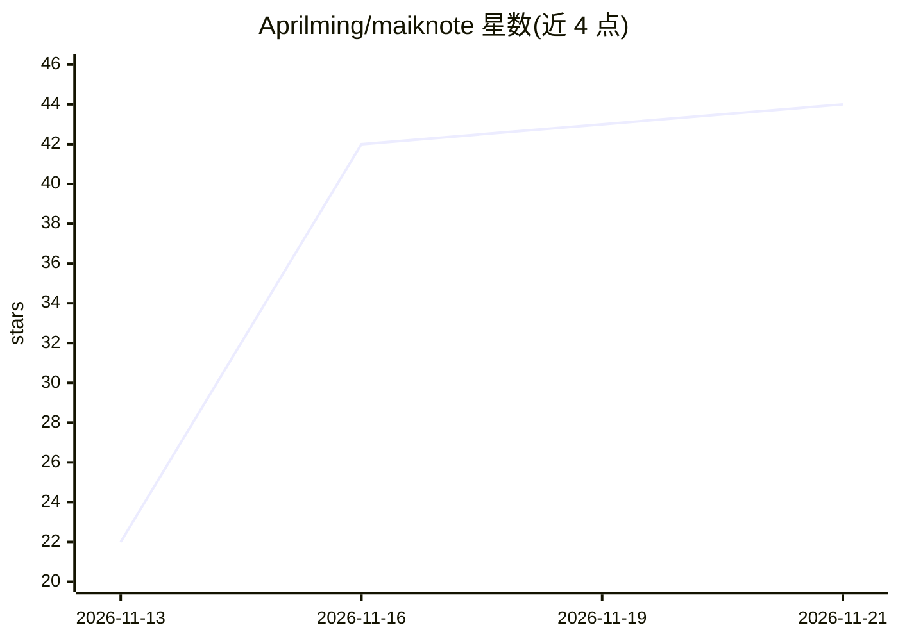

# Aprilming/maiknote

⭐ 44 · Vue · GPL-2.0 · 推送 2026-11-18 · [GitHub](https://github.com/Aprilming/maiknote) · [官网](https://maiknote.91kfc.vip/) · 个人维护 · 中文 README

**macOS 原生 AI Markdown 悬浮便签应用**

基于 Tauri 2.x + Vue 3 的 macOS 悬浮便签：全局快捷键唤起、所见即所得 Markdown 编辑（Notion 风格块操作、斜杠命令、源码模式），笔记以纯 .md 文件存于 iCloud 目录实现多设备同步，另提供桌面笔记卡片、边缘面板、文件夹组织与全局搜索。AI 部分：右键选中局部改写、自定义助手与提示词（默认接 DeepSeek API）、MCP 联网搜索、内置使用教程 Skill 可软链到 Claude Code 等 CLI。许可禁止商业使用，应用未做 Apple 公证需手动解除隔离。

## 筛选速览

| 维度 | 判定 | 备注 |
|---|---|---|
| AI 角色 | `ai-enhanced` | 去掉 AI 部分产品仍成立 |
| 许可风险 | `viral` | GPL-2.0 |
| 部署形态 | `library` | 以包/库形式分发 |
| 模型依赖 | locked-api |  |
| 硬件要求 | — | 无带数字的原话,不猜 |
| 安装摩擦 | `low` | 无编译、无系统依赖或容器化 |
| 成熟度 | — | 结构信号不足 |

## 能力要点

- 笔记为 iCloud 中的纯 .md 文件，文件名即标题
- 右键 AI 改写：有选中只发选中内容，无选中发整篇
- 默认接 DeepSeek API，支持 OpenAI 兼容接口
- 桌面笔记卡片与四向触发的边缘面板

## 适用场景

- macOS 上随手记录与整理 Markdown 笔记
- 写笔记时对选中文字做 AI 局部改写
- 通过 iCloud 在多设备间同步笔记

## 场景标签

`知识库管理` `AI 写作` · 领域:内容生成

## 证据(README 行号)

> L4:  一款 macOS 原生的 AI Markdown 悬浮便签应用
> L10: 全局快捷键随叫随到，所见即所得写 Markdown，笔记以纯 `.md` 文件落在 iCloud 目录里天然多设备同步，并内置 AI 改写与桌面笔记卡片。灵感来自 Antinote，在其基础上深度整合了 AI 能力。本项目完全通过

## 星数曲线

2026-11-13 22 → 2026-11-21 44（+22）

---
*卡片 v1 · prompt 1.4 · 生成 2026-11-18 · 置信度 high · 依据 README sha `7e947eedcfa8` · [字段定义](../../DATASET.md)*
