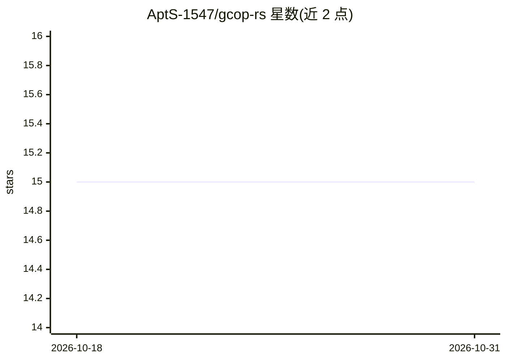

# AptS-1547/gcop-rs

⭐ 15 · Rust · MIT · 推送 2026-10-16 · [GitHub](https://github.com/AptS-1547/gcop-rs) · [官网](https://gcop.docs.esap.cc) · 组织维护 · 中文 README

**AI 生成 Git 提交信息与代码审查的终端 CLI（Rust）**

Rust 编写的 Git 命令行工具：读取暂存区变更，经 Claude/OpenAI/Gemini/Ollama 等模型生成符合 conventional commits 的提交信息，并对工作区变更、指定 commit 或区间执行 AI 代码审查（含安全与性能视角）。支持 monorepo 工作区检测推断 scope、prepare-commit-msg 钩子、git 别名（git c/git r 等）、自定义模板与任何 OpenAI/Claude 兼容 API。生成结果可交互接受/编辑/重试并附加反馈。需 Git 2.0+ 与至少一个 provider 的 API key 或本地 Ollama；源码构建需 Rust 1.88.0+。

## 筛选速览

| 维度 | 判定 | 备注 |
|---|---|---|
| AI 角色 | `ai-native` | 本体是模型或模型工具 |
| 许可风险 | `permissive` | MIT |
| 部署形态 | `library` | 以包/库形式分发 |
| 模型依赖 | local-ok | 支持本地模型 |
| 硬件要求 | — | 无带数字的原话,不猜 |
| 安装摩擦 | `low` | 无编译、无系统依赖或容器化 |
| 成熟度 | — | 结构信号不足 |

## 能力要点

- 多 provider 提交信息生成（Claude/OpenAI/Gemini/Ollama 及兼容 API）
- AI 代码审查：工作区变更/单 commit/区间/单文件
- monorepo 自动检测 Cargo/Pnpm/Npm/Lerna/Nx/Turbo 并推断 scope
- git 别名与 prepare-commit-msg 钩子集成

## 适用场景

- 提交前让 AI 生成规范的 conventional commits 信息
- 在终端对变更执行带安全视角的 AI 代码审查
- monorepo 中自动推断 commit scope

## 场景标签

`代码审查` `AI 写作` · 领域:编码与开发

## 证据(README 行号)

> L8: AI-powered Git CLI — generate commit messages, review code, manage workflows, all from your terminal. Written in Rus
> L16: - **AI Commit Messages** — Generate conventional commits via Claude, OpenAI, Gemini, or Ollama

## 星数曲线

2026-10-18 15 → 2026-10-31 15（+0）

---
*卡片 v1 · prompt 1.4 · 生成 2026-10-31 · 置信度 high · 依据 README sha `df287edb488e` · [字段定义](../../DATASET.md)*
