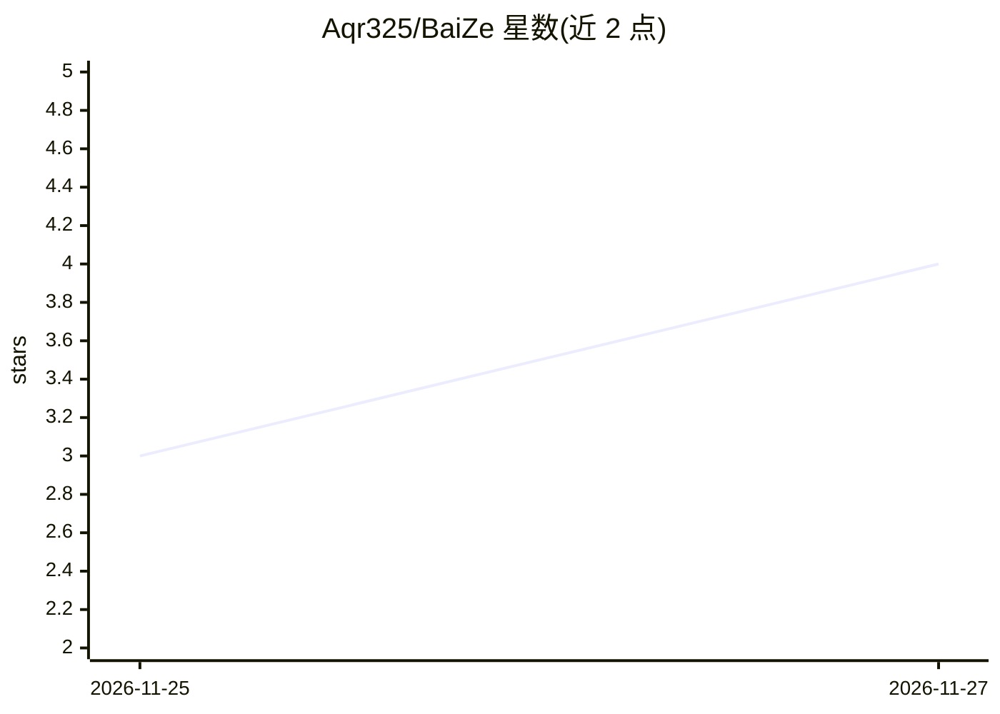

# Aqr325/BaiZe

⭐ 4 · Python · AGPL-3.0 · 推送 2026-11-26 · [GitHub](https://github.com/Aqr325/BaiZe) · 个人维护 · 中文 README

**给安全测试人员的 LLM 多 Agent 自主渗透测试系统**

BaiZe 是基于 Go 的 LLM 多 Agent 自主渗透测试系统：输入一句话目标后自动执行目标拆解、侦察、漏洞挖掘、验证与报告全流程。关键机制包括目标验收闸门、critical/high 漏洞必须附可机械复现证据、资产图与探索图的双图血缘回溯、MITM 代理逐请求留存流量，以及对话纠偏/暂停/人工审批的人在环路控制。作为 RuoJi6/ARTEX 的增强分支，新增记忆系统、子代理委派、群聊协作与 Fence 授权边界。

## 筛选速览

| 维度 | 判定 | 备注 |
|---|---|---|
| AI 角色 | `ai-native` | 本体是模型或模型工具 |
| 许可风险 | `viral` | AGPL-3.0 |
| 部署形态 | `self-host` | docker 或自建部署 |
| 模型依赖 | locked-api |  |
| 硬件要求 | — | 无带数字的原话,不猜 |
| 安装摩擦 | `low` | 无编译、无系统依赖或容器化 |
| 成熟度 | — | 结构信号不足 |

## 能力要点

- planner/worker/mainagent 多 Agent 事件驱动闭环，跨唤醒共享 todolist 稳定推进攻击链
- 双图架构（资产图×探索图）+ 锚点缝合，发现可回溯线索血缘
- MITM 代理全程留痕，finding 绑定四类流量证据并版本化（sha256）
- 三层拦截闸门（deny/judge/ask）+ 成本预算闸 + 多通道 LLM 轮询

## 适用场景

- 对授权目标执行一句话发起的外网暴露面渗透测试
- 需要可回放证据链的漏洞验证与交付报告生成
- 多 Agent 协作下的资产测绘与漏洞去重复测

## 场景标签

`多智能体` `网络安全` · 领域:Agent 开发

## 证据(README 行号)

> L5: **AI 自主渗透测试系统 · 从一句话目标到可交付漏洞报告**
> L62: BaiZe 是一套 **LLM 多 Agent 自主渗透测试系统**：给一句话目标，它自动完成「目标拆解 → 侦察 → 漏洞挖掘 → 验证 → 报告」全流程，人随时可以插手纠偏。
> L18: **Go 单体后端** · **Next.js 内嵌前端** · **PostgreSQL** · **多 Agent 自主推进** · **全程证据留痕** · **人在环路纠偏**

## 星数曲线

2026-11-25 3 → 2026-11-27 4（+1）

---
*卡片 v1 · prompt 1.4 · 生成 2026-11-24 · 置信度 high · 依据 README sha `aee3d2ba4243` · [字段定义](../../DATASET.md)*
