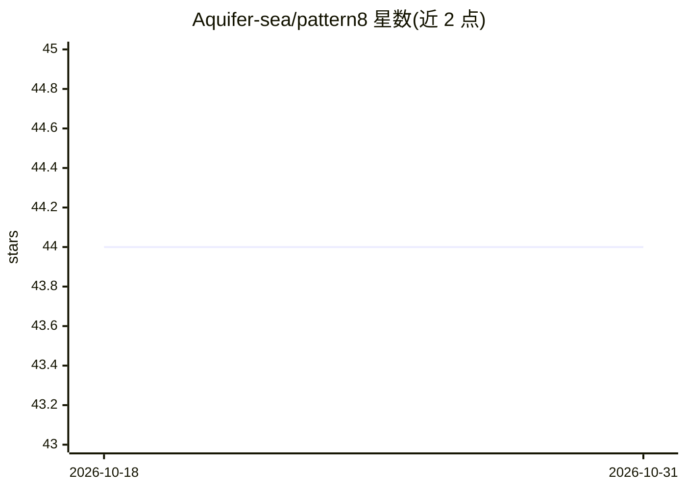

# Aquifer-sea/pattern8

⭐ 44 · Python · MIT · 推送 2026-03-24 · [GitHub](https://github.com/Aquifer-sea/pattern8) · [官网](https://pypi.org/project/pattern8/) · 个人维护 · 中文 README

**约束 AI Agent 行为的零信任治理框架（规则+MCP 执行引擎）**

面向使用 AI 编码代理（Claude、Cursor、Windsurf 等）的开发者：P8 不调用 LLM、不驱动流水线，而是以可编辑的 Markdown/YAML 规则文件（Law）配合只读 MCP stdio 执行引擎（Police）约束 Agent 行为。通过 5 种强制模式（Pipeline、Inversion、Generator、Tool Wrapper、Reviewer）实现命令黑名单拦截、模板校验与不合规输出的回滚重试（最多 3 次），审计规则文件对 Agent 隐藏以防规避。内置 5 个开发 SKILL（PRD、Bug Fix、Code Review、Refactor、Feature Dev），提供 CLI、pre-commit 钩子与 Cursor 等 IDE 的 MCP 配置生成。需 Python 3.8+，完整强制功能需 pip 安装 enforcement 扩展。

## 筛选速览

| 维度 | 判定 | 备注 |
|---|---|---|
| AI 角色 | `ai-ecosystem` | LLM/agent 周边工具 |
| 许可风险 | `permissive` | MIT |
| 部署形态 | `library` | 以包/库形式分发 |
| 模型依赖 | — | README 未给出锁定关系 |
| 硬件要求 | — | 无带数字的原话,不猜 |
| 安装摩擦 | `low` | 无编译、无系统依赖或容器化 |
| 成熟度 | — | 结构信号不足 |

## 能力要点

- MCP SecurityGuard 在 OS 层拦截黑名单命令与非法路径
- Reviewer 静态审计（regex/format/length 4 类规则），不合规触发回滚重试最多 3 次
- 审计标准 security.yaml/guidelines.yaml 对 Agent 隐藏以防规避审计
- 内置 5 个开发 SKILL，支持 p8 init --lang zh 生成中文 SKILL 文件

## 适用场景

- 防止 AI 编码代理执行危险命令或跳过测试流程
- 强制 Agent 按 checklist 与模板输出结构化交付物
- 用 pre-commit 钩子扫描暂存文件中的硬编码密钥

## 场景标签

`Agent 框架` · 领域:Agent 开发

## 证据(README 行号)

> L50: P8 is **NOT** an AI Agent framework. It does not call LLMs or drive pipelines.

## 星数曲线

2026-10-18 44 → 2026-10-31 44（+0）

---
*卡片 v1 · prompt 1.4 · 生成 2026-10-25 · 置信度 mid · 依据 README sha `3c0a009f9f57` · [字段定义](../../DATASET.md)*
