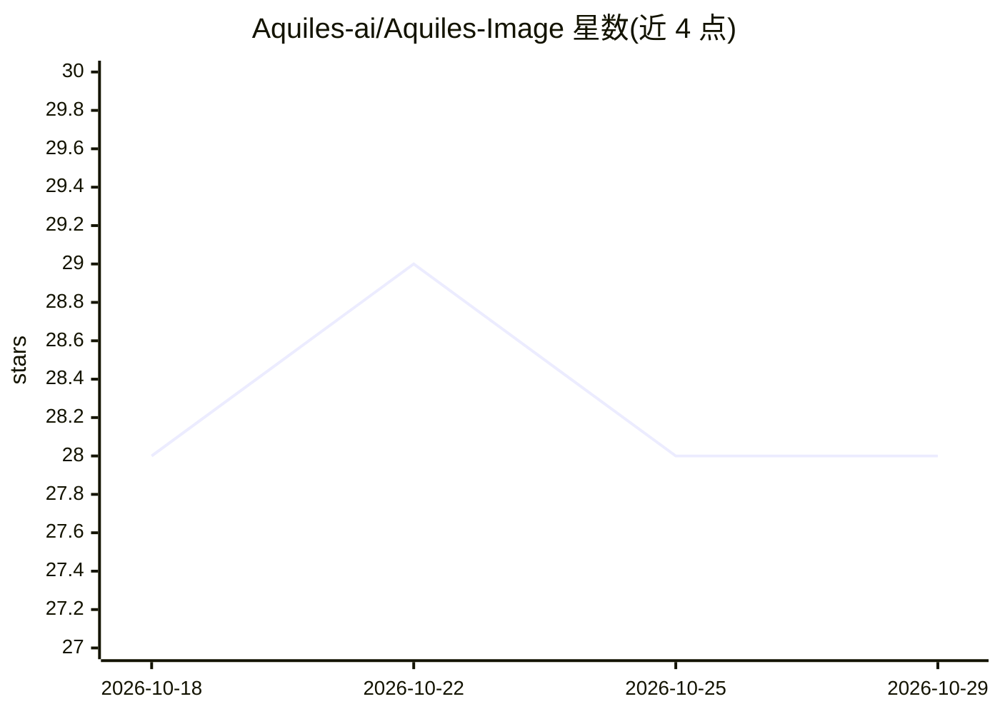

# Aquiles-ai/Aquiles-Image

⭐ 28 · Python · Apache-2.0 · 推送 2026-10-28 · [GitHub](https://github.com/Aquiles-ai/Aquiles-Image) · [官网](https://aquiles-ai.vercel.app) · 组织维护

**自托管扩散模型图像/视频生成推理服务器，OpenAI 兼容 API**

基于 FastAPI 与 Diffusers 的图像/视频生成推理服务器，提供 OpenAI 兼容的 /images/generations、/images/edits、/videos 接口，可用官方 OpenAI 客户端零改动调用。原生支持 30+ 模型（FLUX、SD3.5、Qwen-Image、Wan2.x、HunyuanVideo、LTX-2、MiniMax-H3 等），并可通过 AutoPipeline 运行任意 Diffusers 模型（实验性、推理较慢）。支持多 GPU 分布式推理、按参数分组批处理、LoRA 加载、GGUF 量化与内置基准测试。面向需要在自有 GPU 硬件上部署生成服务的开发者，通过 pip 或 Docker（CUDA 13.0）安装。

## 筛选速览

| 维度 | 判定 | 备注 |
|---|---|---|
| AI 角色 | `ai-ecosystem` | LLM/agent 周边工具 |
| 许可风险 | `permissive` | Apache-2.0 |
| 部署形态 | `self-host` | docker 或自建部署 |
| 模型依赖 | local-ok | 支持本地模型 |
| 硬件要求 | — | 无带数字的原话,不猜 |
| 安装摩擦 | `low` | 无编译、无系统依赖或容器化 |
| 成熟度 | — | 结构信号不足 |

## 能力要点

- OpenAI 兼容 API，官方 OpenAI 客户端零代码改动接入
- 原生支持 30+ 图像/视频模型 + AutoPipeline 运行任意 Diffusers 模型
- 多 GPU 分布式推理与动态负载均衡、参数共享批处理
- LoRA 加载、GGUF 量化、内置吞吐/延迟基准测试

## 适用场景

- 把外部图像 API 切换到自有 GPU 上的自托管服务
- 在多 GPU 服务器上横向扩展图像生成吞吐
- 用同一套 API 服务统一提供文生图、图生图与文生视频能力
- 为 Diffusers 生态模型快速搭建推理端点并加载 LoRA

## 场景标签

`图像生成` `视频生成` `推理引擎` · 领域:内容生成

## 证据(README 行号)

> L21: **Aquiles-Image** is a production-ready API server that lets you run state-of-the-art image and video generation mo
> L37: - **🔌 OpenAI Compatible** - Use the official OpenAI client with zero code changes

## 星数曲线

2026-10-18 28 → 2026-10-29 28（+0）

---
*卡片 v1 · prompt 1.4 · 生成 2026-10-26 · 置信度 high · 依据 README sha `e865d91500de` · [字段定义](../../DATASET.md)*
