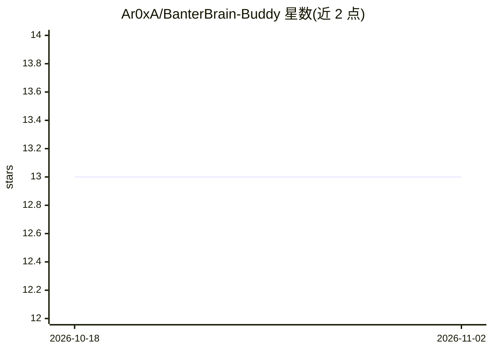

# Ar0xA/BanterBrain-Buddy

⭐ 13 · C# · GPL-3.0 · 推送 2026-07-29 · [GitHub](https://github.com/Ar0xA/BanterBrain-Buddy) · 个人维护

**Windows 语音对话陪伴程序：语音转文字→LLM→语音合成**

基于 .NET 8 的 Windows 桌面程序，面向主播与普通娱乐用户：采集语音经语音转文字送入 LLM（OpenAI ChatGPT API 或本地 Ollama），再将回复经 TTS 语音播出，可设置 AI 角色人设。支持 Azure、Windows 原生、ElevenLabs 等多种 TTS 语音，集成 Twitch 聊天命令与直播事件响应。README 首行声明该项目已被弃置。运行需 .NET Runtime Desktop 8 与 OpenAI API key 或本地 Ollama 安装。

## 筛选速览

| 维度 | 判定 | 备注 |
|---|---|---|
| AI 角色 | `ai-native` | 本体是模型或模型工具 |
| 许可风险 | `viral` | GPL-3.0 |
| 部署形态 | `None` |  |
| 模型依赖 | local-ok | 支持本地模型 |
| 硬件要求 | — | 无带数字的原话,不猜 |
| 安装摩擦 | `medium` | 含编译或系统依赖之一 |
| 成熟度 | `idea` | |

## 能力要点

- 语音转文字→LLM→语音合成的对话流程，可自定义 AI 人设角色
- 支持 OpenAI ChatGPT API 与本地 Ollama 双通道
- Twitch 聊天命令与直播事件响应，含订阅者识别与敏感词过滤
- 多种 TTS 语音（Azure/Windows 原生/ElevenLabs/OpenAI Whisper）可调语速音量音调

## 适用场景

- 直播时与 AI 语音互动作为陪伴节目效果
- 通过 Twitch 聊天命令触发 AI 语音回应观众
- 本地运行（Ollama + 本地资源）进行纯本机语音对话

## 场景标签

`语音 Agent` · 领域:对话与助手

## 证据(README 行号)

> L180: BanterBrain Buddy is a Windows .Net based Speech-To-Text to LLM to Text-To-Speech program for general entertainmen
> L182: The goal is to provide local PC or streaming entertainment by talking to an AI and hearing the responses back, bas

## 星数曲线

2026-10-18 13 → 2026-11-02 13（+0）

---
*卡片 v1 · prompt 1.4 · 生成 2026-10-31 · 置信度 high · 依据 README sha `1fcce0a9cda5` · [字段定义](../../DATASET.md)*
