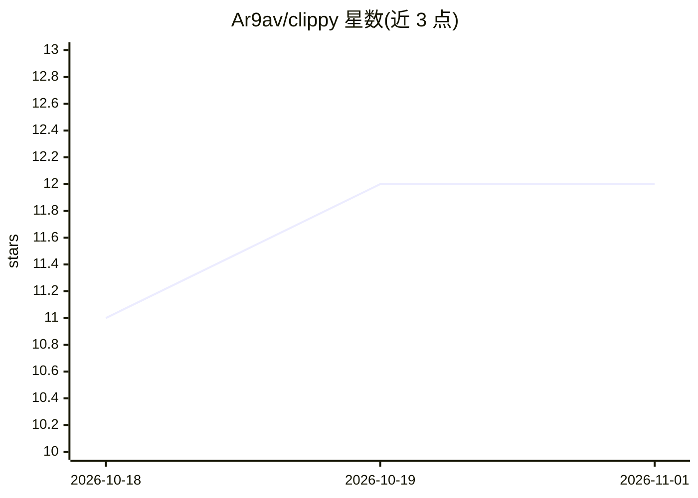

# Ar9av/clippy

⭐ 12 · Swift · MIT · 推送 2026-08-28 · [GitHub](https://github.com/Ar9av/clippy) · [官网](https://github.com/Ar9av/clippy/releases/latest) · 个人维护

**macOS 桌面 AI 代理：读取屏幕并代你点击、输入完成操作**

Swift 编写的 macOS 桌面助手应用，形似回形针浮窗。用户发出指令后，它截屏并扫描前台的辅助功能树（控件标签、角色、状态），按"看一步—规划一步—执行—再看"循环代替用户完成点击与输入，支持滚动查找、坐标点击、失败重试与跨会话记忆。安全机制上无条件拒绝 Send/Submit/支付/密码等不可逆控件，规则由 Prismor 策略 YAML 定义且缺失时整体停用。提供 OpenAI/Anthropic API、Claude Code/Codex 登录及本地 OpenAI 兼容服务器多种接入方式。

## 筛选速览

| 维度 | 判定 | 备注 |
|---|---|---|
| AI 角色 | `ai-native` | 本体是模型或模型工具 |
| 许可风险 | `permissive` | MIT |
| 部署形态 | `desktop` | 安装包/桌面程序 |
| 模型依赖 | local-ok | 支持本地模型 |
| 硬件要求 | — | 无带数字的原话,不猜 |
| 安装摩擦 | `low` | 无编译、无系统依赖或容器化 |
| 成熟度 | — | 结构信号不足 |

## 能力要点

- 每步截图+辅助功能树扫描的看-做-再看执行循环
- 无条件拒绝发送/提交/支付/密码等不可逆操作，策略失败即整体停止
- 支持 Claude Code/Codex 登录、OpenAI/Anthropic API key（存入 Keychain）及本地模型
- 跨会话记忆可在设置中逐条查看与删除

## 适用场景

- 让 AI 直接代为操作系统设置、浏览器搜索等界面任务
- 读屏解释报错内容而无需复制粘贴
- 把讨论内容填入指定输入框（不代为提交）

## 场景标签

`GUI 自动化` · 领域:效率与自动化

## 证据(README 行号)

> L7:  Ask it to do something on your Mac and it takes a screenshot, reads the
> L77:  look  ──▶  plan one step  ──▶  do it  ──▶  look again  ──▶  done?

## 星数曲线

2026-10-18 11 → 2026-11-01 12（+1）

---
*卡片 v1 · prompt 1.4 · 生成 2026-11-01 · 置信度 high · 依据 README sha `38bb88efa336` · [字段定义](../../DATASET.md)*
