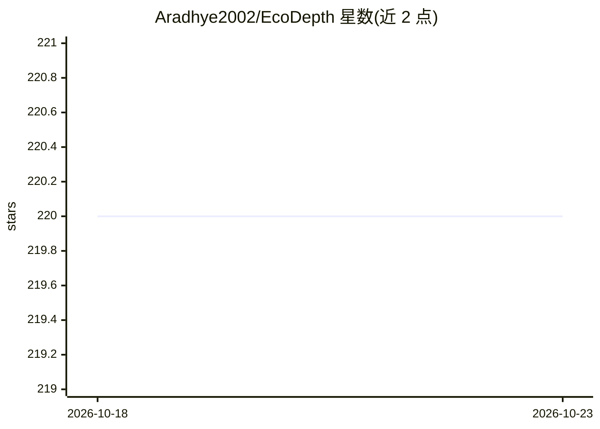

# Aradhye2002/EcoDepth

⭐ 220 · Python · NOASSERTION · 推送 2025-11-20 · [GitHub](https://github.com/Aradhye2002/EcoDepth) · [官网](https://ecodepth-iitd.github.io/) · 组织维护

**CVPR 2024 单目深度估计模型官方实现：从图像/视频生成深度图**

ECoDepth 论文（CVPR 2024）的官方 PyTorch 代码，基于扩散模型条件化做单目深度估计（MDE）。v2.0.0 重构版提供首次运行自动下载并缓存 NYUv2/KITTI 预训练权重、通用 DepthDataset 模块加载自定义数据集、PyTorch Lightning 训练/推理集成、JSON 配置化工作流（train/test/infer 三目录分离），并支持导出 ONNX/TorchScript。提供图像与视频推理脚本，输出深度图（灰度或彩色化）。训练需基于已发布 checkpoint 微调，不支持完全从零训练。

## 筛选速览

| 维度 | 判定 | 备注 |
|---|---|---|
| AI 角色 | `ai-native` | 本体是模型或模型工具 |
| 许可风险 | `none` | NOASSERTION |
| 部署形态 | `library` | 以包/库形式分发 |
| 模型依赖 | — | README 未给出锁定关系 |
| 硬件要求 | — | 无带数字的原话,不猜 |
| 安装摩擦 | `medium` | 含编译或系统依赖之一 |
| 成熟度 | — | 结构信号不足 |

## 能力要点

- 首次运行自动下载并缓存预训练 checkpoint
- 通用 DepthDataset 模块支持任意 RGB-深度对数据集训练
- PyTorch Lightning 集成，可导出 ONNX/TorchScript
- 提供图像与视频深度推理脚本（flip_test、分辨率控制等）

## 适用场景

- 对图像或视频做单目深度估计推理
- 在自定义 RGB-深度数据集上微调模型
- 复现论文在 NYUv2/KITTI 上的训练与评测结果

## 场景标签

`图像视频处理` `微调` · 领域:感知与多模态

## 证据(README 行号)

> L13: Welcome to the **restructured codebase** for **ECoDepth**, our official implementation for monocular depth estimati
> L210:   title     = {ECoDepth: Effective Conditioning of Diffusion Models for Monocular Depth Estimation},

## 星数曲线

2026-10-18 220 → 2026-10-23 220（+0）

---
*卡片 v1 · prompt 1.4 · 生成 2026-10-22 · 置信度 high · 依据 README sha `1f9b3af9fb44` · [字段定义](../../DATASET.md)*
