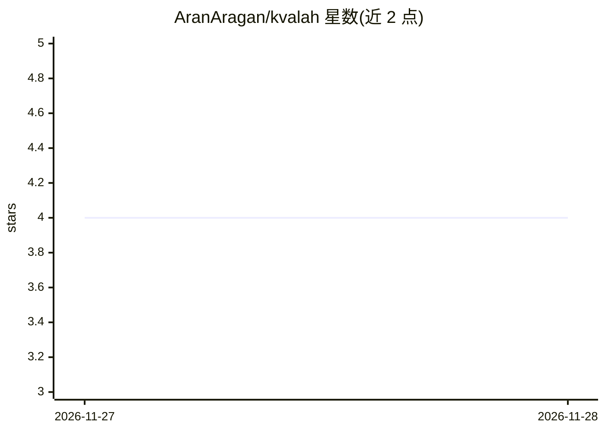

# AranAragan/kvalah

⭐ 4 · JavaScript · MIT · 推送 2026-11-27 · [GitHub](https://github.com/AranAragan/kvalah) · [官网](https://github.com/AranAragan/kvalah/releases) · 个人维护

**本地开源模型（7–32B）的桌面编码 agent，单机家用 GPU 运行**

面向家庭硬件的本地编码 agent：针对 7–32B 开源权重模型与 8–32K 上下文设计，按 inspect→plan→edit→verify 流程工作，任务只有在测试/构建/运行等真实检查通过后才标记完成。Ollama 原生接入，LM Studio、llama.cpp、vLLM、LocalAI、Jan 经 OpenAI 兼容 API 接入；对小模型提供文本协议工具调用与 JSON 修复。提供影子 Git 检查点与回滚、三级审批模式、ripgrep 代码检索，并支持多机内存池化（llama.cpp RPC）与子任务分布式执行。Windows/macOS/Linux 提供安装包，Electron 桌面应用。

## 筛选速览

| 维度 | 判定 | 备注 |
|---|---|---|
| AI 角色 | `ai-native` | 本体是模型或模型工具 |
| 许可风险 | `permissive` | MIT |
| 部署形态 | `desktop` | 安装包/桌面程序 |
| 模型依赖 | local-ok | 支持本地模型 |
| 硬件要求 | — | 无带数字的原话,不猜 |
| 安装摩擦 | `medium` | 含编译或系统依赖之一 |
| 成熟度 | — | 结构信号不足 |

## 能力要点

- inspect→plan→edit→verify 流程，任务须通过真实检查（测试/构建/运行）才算完成
- 影子 Git 快照检查点、逐编辑撤销与冲突检测
- 多机 Pool memory：llama.cpp RPC 把大 GGUF 模型拆分到多台电脑；Distribute tasks 并行子任务
- 10 种 UI 语言，含简体中文

## 适用场景

- 在单张家用 GPU 上用 7–32B 本地模型完成编码任务
- 通过 LM Studio / llama-server / vLLM 等已有本地服务接入 agent
- 把多台局域网电脑的内存合并运行更大的模型
- 需要检查点回滚与审批模式的本地 agent 工作流

## 场景标签

`编码 Agent` · 领域:编码与开发

## 证据(README 行号)

> L5:  A reliable coding agent for 7–32B open models on a single home GPU.
> L16: Big cloud agents assume a frontier model and 64K+ of context. kvalah is built for the model you can actually run at
> L20: - **Works with any local model server.** Ollama natively; LM Studio, llama.cpp `llama-server`, vLLM, LocalAI, Jan t

## 星数曲线

2026-11-27 4 → 2026-11-28 4（+0）

---
*卡片 v1 · prompt 1.4 · 生成 2026-11-27 · 置信度 high · 依据 README sha `01d786271061` · [字段定义](../../DATASET.md)*
