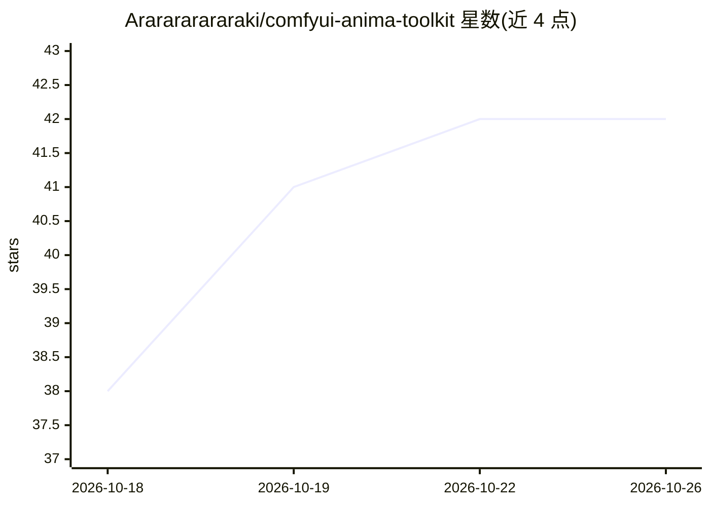

# Ararararararaki/comfyui-anima-toolkit

⭐ 42 · JavaScript · MIT · 推送 2026-10-21 · [GitHub](https://github.com/Ararararararaki/comfyui-anima-toolkit) · [官网](https://ararararararaki.github.io/comfyui-anima-toolkit/) · 个人维护 · 中文 README

**ComfyUI 插件：批量 LoRA 管理、Danbooru 画廊与提示词工具一站式工具包**

面向 ComfyUI 用户的自定义节点包加内置网页面板，覆盖五类功能：LoRA 批量加载与本地管理（按 SHA256 匹配 Civitai 元数据、补预览图、下载）、提示词管理（中英对照卡片、翻译源切换、中文标签补全）、Danbooru 等六个图源的标签搜索与瀑布流画廊、output 目录出图管理（PNG 参数解析、WD14 识别归类），以及批量提示词出图辅助节点。另含 TK Prompt Agent 节点，可接用户自配的兼容模型 API 用中文创作/反推提示词。依赖 ComfyUI（2024 年后版本），模型与密钥由用户自行配置；只管推理侧，不做 LoRA 训练。

## 筛选速览

| 维度 | 判定 | 备注 |
|---|---|---|
| AI 角色 | `ai-ecosystem` | LLM/agent 周边工具 |
| 许可风险 | `permissive` | MIT |
| 部署形态 | `library` | 以包/库形式分发 |
| 模型依赖 | — | README 未给出锁定关系 |
| 硬件要求 | — | 无带数字的原话,不猜 |
| 安装摩擦 | `low` | 无编译、无系统依赖或容器化 |
| 成熟度 | — | 结构信号不足 |

## 能力要点

- TK 批量 LoRA 加载器：面板挑选、批量启用、权重拖动调整、触发词输出
- 六个图源（Danbooru/Civitai/Pixiv/Safebooru/yande.re/Konachan.net）标签搜索与瀑布流画廊
- 内置 AnimaDex 本地角色库（36,488 角色，随包数据，离线本地选词拼接，不调用 LLM）
- TK Prompt Batch 读本地提示词文件按组串行批量出图，配套 AI 撰写 skill（SKILL.md）

## 适用场景

- 给 ComfyUI 工作流批量挂载和管理几十个 LoRA 并补全 Civitai 元数据
- 按标签在 Danbooru 等图源搜参考图、找画师风格
- 用中英对照卡片整理提示词并用批量提示词节点一次跑一批出图
- 把 output 目录整理成带参数解析的缩略图画廊

## 场景标签

`提示工程` · 领域:Agent 开发

## 证据(README 行号)

> L11: 给 ComfyUI 用的 Anima 工作流工具包。批量挂 LoRA、管理本地模型、搜图找参考、整理提示词、翻看历史出图，都收在一个插件里，另外配一个本地管理面板。
> L15: > 英文简介：TK Toolkit（2026-09 之前叫 Anima Toolkit，插件本身和 Registry id `anima-toolkit` 都没变）是 ComfyUI 的自定义节点包，外加一个内置网页面板。它管五件

## 星数曲线

2026-10-18 38 → 2026-10-26 42（+4）

---
*卡片 v1 · prompt 1.4 · 生成 2026-10-25 · 置信度 mid · 依据 README sha `3edbaac409e3` · [字段定义](../../DATASET.md)*
