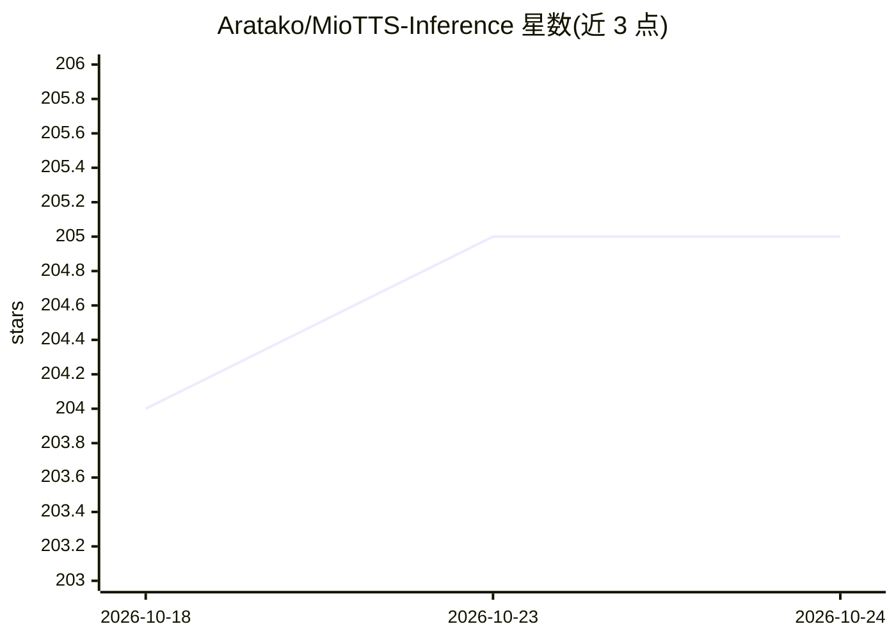

# Aratako/MioTTS-Inference

⭐ 205 · Python · MIT · 推送 2026-02-14 · [GitHub](https://github.com/Aratako/MioTTS-Inference) · [官网](https://huggingface.co/collections/Aratako/miotts) · 个人维护 · 中文 README

**轻量 LLM 语音合成模型 MioTTS 的推理与语音合成 API 服务**

为 LLM 架构的 TTS 模型 MioTTS（0.1B-2.6B 多个规格）提供推理方案：因模型架构与标准 LLM 相同，可搭配 llama.cpp、Ollama、vLLM 等通用推理框架运行推理服务器（需提供 OpenAI 兼容 API），本仓库再提供语音合成 REST API 服务与 Gradio WebUI。功能包括参考音频预设注册（含日/英男女声四个默认预设）、Best-of-N 候选生成并按 Whisper ASR 错误率启发式选优、日语文本正规化。语音克隆参考音频上限 20 秒。代码 MIT 许可，各模型许可不一。

## 筛选速览

| 维度 | 判定 | 备注 |
|---|---|---|
| AI 角色 | `ai-native` | 本体是模型或模型工具 |
| 许可风险 | `permissive` | MIT |
| 部署形态 | `library` | 以包/库形式分发 |
| 模型依赖 | local-ok | 支持本地模型 |
| 硬件要求 | — | 无带数字的原话,不猜 |
| 安装摩擦 | `medium` | 含编译或系统依赖之一 |
| 成熟度 | — | 结构信号不足 |

## 能力要点

- 兼容 llama.cpp / Ollama / vLLM 等 LLM 推理框架（OpenAI 兼容 API）
- REST API 语音合成 + Gradio WebUI + 参考音频预设机制
- Best-of-N 并行生成并按 Whisper ASR 错误率启发式选优
- 0.1B-2.6B 六个模型规格及 GGUF 量化版本

## 适用场景

- 自建 TTS 服务并通过 REST API 调用语音合成
- 用参考音频克隆音色或使用内置日/英语预设音色
- 在消费级 GPU 上用 llama.cpp/Ollama 跑量化 TTS 模型

## 场景标签

`语音合成` · 领域:内容生成

## 证据(README 行号)

> L11: Inference code for MioTTS, a lightweight and fast TTS model.
> L14: - Compatible with common LLM inference frameworks (llama.cpp, Ollama, vLLM, etc.)

## 星数曲线

2026-10-18 204 → 2026-10-24 205（+1）

---
*卡片 v1 · prompt 1.4 · 生成 2026-10-22 · 置信度 mid · 依据 README sha `9282d9aae48e` · [字段定义](../../DATASET.md)*
