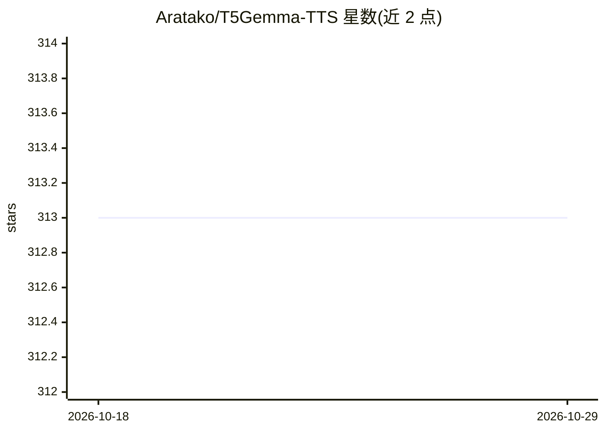

# Aratako/T5Gemma-TTS

⭐ 313 · Python · MIT · 推送 2026-04-03 · [GitHub](https://github.com/Aratako/T5Gemma-TTS) · [官网](https://huggingface.co/Aratako/T5Gemma-TTS-2b-2b) · 个人维护 · 中文 README

**基于编码器-解码器 LLM 的多语言 TTS 模型，支持音色克隆与时长控制**

T5Gemma-TTS 是基于 Encoder-Decoder LLM 架构的英文/中文/日文文本转语音模型，提供数据预处理、训练（含 LoRA 微调）、模型转换与推理的完整脚本。推理支持命令行、HuggingFace 格式与 Gradio UI 三种方式，可从参考音频做零样本音色克隆，显式指定目标时长，或从同一输入并行生成多个音频候选。提供 8/4-bit 编码器量化模型、CPU offloading 等低显存选项，并测试了 Linux+CUDA、Docker 与 Apple Silicon (MPS) 环境。自述限制：自回归生成速度慢，不适合低延迟实时场景。

## 筛选速览

| 维度 | 判定 | 备注 |
|---|---|---|
| AI 角色 | `ai-native` | 本体是模型或模型工具 |
| 许可风险 | `permissive` | MIT |
| 部署形态 | `self-host` | docker 或自建部署 |
| 模型依赖 | — | README 未给出锁定关系 |
| 硬件要求 | — | 无带数字的原话,不猜 |
| 安装摩擦 | `low` | 无编译、无系统依赖或容器化 |
| 成熟度 | — | 结构信号不足 |

## 能力要点

- 英文/中文/日文多语言合成，零样本参考音频音色克隆
- 显式时长控制与同一输入并行生成多个音频变体（1-256）
- 全量微调与 LoRA 微调脚本，附数据预处理与模型转换工具
- 8/4-bit 编码器量化与 --low_vram 选项降低显存占用

## 适用场景

- 用参考音频克隆音色合成中英日语音
- 为同一文本生成多个候选音频再挑选
- 在自己或公开数据集上微调个性化 TTS 模型

## 场景标签

`语音合成` `微调` · 领域:内容生成

## 证据(README 行号)

> L12: Training and inference code for **T5Gemma-TTS**, a multilingual Text-to-Speech model based on the Encoder-Decoder L
> L30: - **Multilingual TTS**: Supports English, Chinese, and Japanese
> L31: - **Voice Cloning**: Zero-shot voice cloning from reference audio

## 星数曲线

2026-10-18 313 → 2026-10-29 313（+0）

---
*卡片 v1 · prompt 1.4 · 生成 2026-10-21 · 置信度 high · 依据 README sha `bb779a92bfa9` · [字段定义](../../DATASET.md)*
