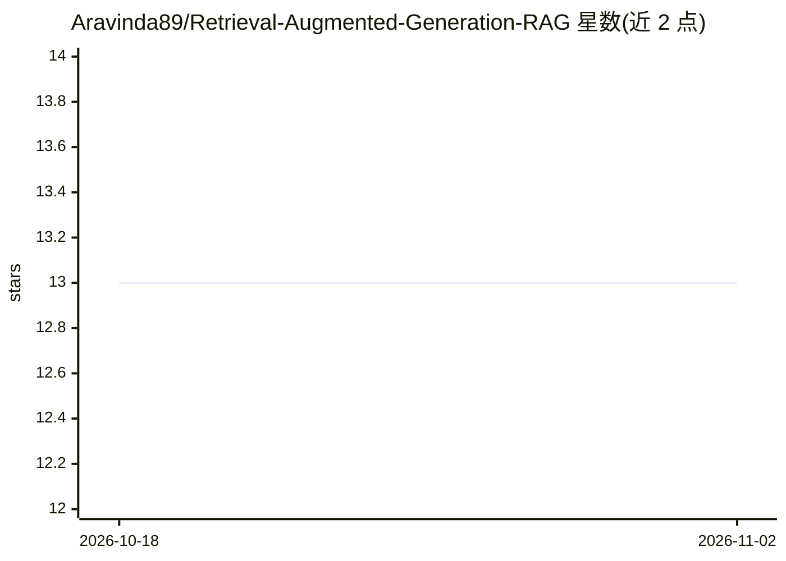

# Aravinda89/Retrieval-Augmented-Generation-RAG

⭐ 13 · Jupyter Notebook · MIT · 推送 2026-09-27 · [GitHub](https://github.com/Aravinda89/Retrieval-Augmented-Generation-RAG) · 个人维护

**deeplearning.ai RAG 课程的学习笔记与代码仓库**

个人学习仓库，存放 deeplearning.ai 的 Retrieval Augmented Generation（RAG）课程相关内容，README 仅含标题、课程出处与一句项目名，未描述具体功能、安装方法或使用说明。从主题标签（rag、llm、deeplearning-ai）可判断其围绕检索增强生成与 LLM 课程材料。仓库未提供依赖说明、许可证或文档结构，内容规模与组织方式无法从 README 核实。

## 筛选速览

| 维度 | 判定 | 备注 |
|---|---|---|
| AI 角色 | `ai-knowledge` | 知识聚合/清单类 |
| 许可风险 | `permissive` | MIT |
| 部署形态 | `None` |  |
| 模型依赖 | — | README 未给出锁定关系 |
| 硬件要求 | — | 无带数字的原话,不猜 |
| 安装摩擦 | `low` | 无编译、无系统依赖或容器化 |
| 成熟度 | — | 结构信号不足 |

## 能力要点

- 围绕 deeplearning.ai RAG 课程内容
- 主题标签标注 rag 与 llm

## 适用场景

- 查阅 deeplearning.ai RAG 课程的学习资料

## 场景标签

`教程课程` · 领域:学习与行业

## 证据(README 行号)

> L1: # Retrieval Augmented Generation RAG
> L2: Retrieval Augmented Generation (RAG) deeplearning.ai

## 星数曲线

2026-10-18 13 → 2026-11-02 13（+0）

---
*卡片 v1 · prompt 1.4 · 生成 2026-10-31 · 置信度 low · 依据 README sha `965836bff410` · [字段定义](../../DATASET.md)*
