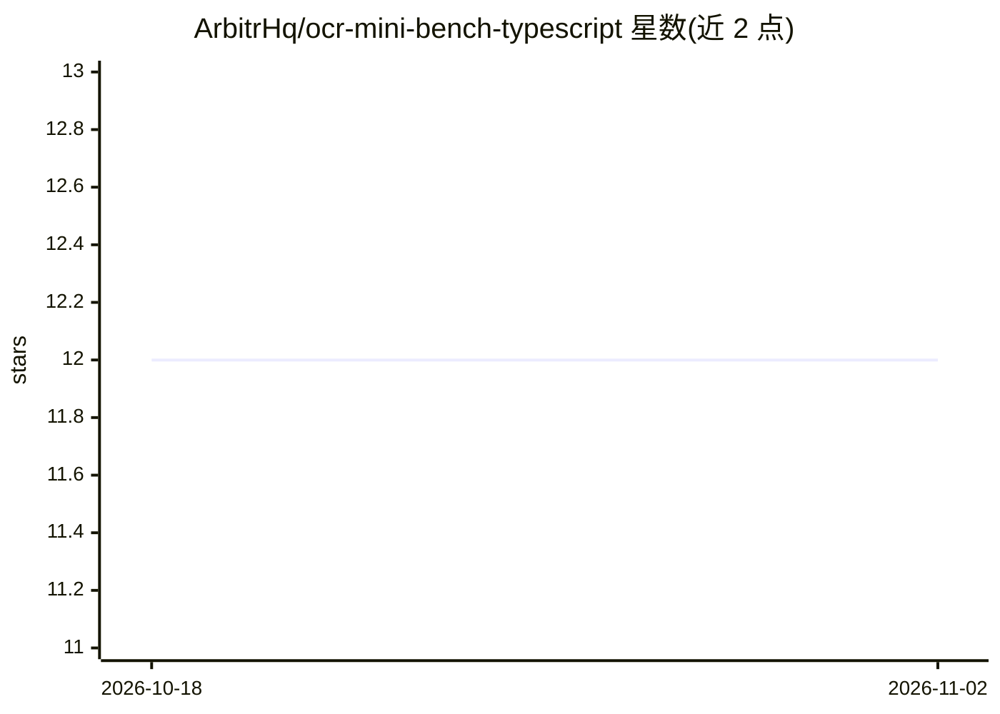

# ArbitrHq/ocr-mini-bench-typescript

⭐ 12 · TypeScript · MIT · 推送 2026-07-03 · [GitHub](https://github.com/ArbitrHq/ocr-mini-bench-typescript) · [官网](https://arbitrhq.ai/blog/new-release-ocr-benchmark/) · 组织维护

**比较多个 LLM 提供商 OCR 抽取质量的基准测试**

TypeScript 编写的轻量级可复现 OCR 基准：在发票、收据、物流等商业文档上，比较多个 LLM 提供商（openai、anthropic、google、mistral）的抽取质量、可靠性、延迟与成本。数据集带逐文档 ground-truth JSON 标签，通过 CLI 运行与过滤模型，支持断点续跑、滚动成本估算，后处理管线生成对比与排行榜工件，并附带最小前端 UI 用于查看排行榜与调试。

## 筛选速览

| 维度 | 判定 | 备注 |
|---|---|---|
| AI 角色 | `ai-ecosystem` | LLM/agent 周边工具 |
| 许可风险 | `permissive` | MIT |
| 部署形态 | `library` | 以包/库形式分发 |
| 模型依赖 | locked-api |  |
| 硬件要求 | — | 无带数字的原话,不猜 |
| 安装摩擦 | `low` | 无编译、无系统依赖或容器化 |
| 成熟度 | — | 结构信号不足 |

## 能力要点

- 跨 openai/anthropic/google/mistral 四类提供商比较 OCR 抽取质量、延迟与成本
- 发票/收据/物流文档数据集，附逐文档 ground-truth JSON 标签
- 断点续跑（state.json）与滚动成本估算
- 附带排行榜/调试前端 UI 与 npm 脚本化流水线

## 适用场景

- 为商业文档 OCR 场景选型 LLM 模型
- 对比不同模型在质量、延迟、成本上的表现
- 复现或扩展 OCR 基准结果并发布排行榜

## 场景标签

`模型评测` `OCR` · 领域:评测与运维

## 证据(README 行号)

> L13: A lightweight, reproducible benchmark to compare OCR extraction quality, reliability, latency, and cost across mult
> L231: Supported providers: `openai`, `anthropic`, `google`, `mistral`

## 星数曲线

2026-10-18 12 → 2026-11-02 12（+0）

---
*卡片 v1 · prompt 1.4 · 生成 2026-11-01 · 置信度 high · 依据 README sha `c2da53230a57` · [字段定义](../../DATASET.md)*
