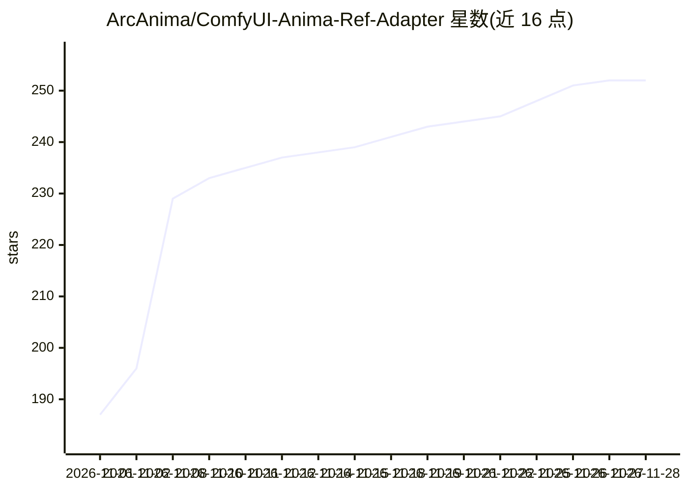

# ArcAnima/ComfyUI-Anima-Ref-Adapter

⭐ 252 · Python · Apache-2.0 · 推送 2026-11-11 · [GitHub](https://github.com/ArcAnima/ComfyUI-Anima-Ref-Adapter) · 个人维护

**ComfyUI 参考图角色与风格迁移节点：保持人物，姿势由提示词控制**

为 ComfyUI 提供 Anima 模型的参考图适配器（v2）：输入一张参考图与仅描述场景的提示词，节点保持人物外貌与部分画风，姿势、背景与构图由提示词决定；支持单图单角色与两张参考图并排的双角色生成。实现方式为 offset-RoPE 参考帧的非对称注意力加 rank-64 LoRA，参考 K/V 每图仅编码一次。以 git clone 安装的自定义节点形式发布，权重首次运行时从 Hugging Face 下载（183 MB）。README 声明因缺乏资金开发暂停，不再继续训练。

## 筛选速览

| 维度 | 判定 | 备注 |
|---|---|---|
| AI 角色 | `ai-native` | 本体是模型或模型工具 |
| 许可风险 | `permissive` | Apache-2.0 |
| 部署形态 | `None` |  |
| 模型依赖 | — | README 未给出锁定关系 |
| 硬件要求 | — | 无带数字的原话,不猜 |
| 安装摩擦 | `low` | 无编译、无系统依赖或容器化 |
| 成熟度 | — | 结构信号不足 |

## 能力要点

- 单节点接入标准 Anima 工作流，兼容任意采样器（KSampler 等）
- 非对称注意力：参考 K/V 每图编码一次并在各步复用（v2 相比 pilot 每步约快 2.1x）
- 支持两张参考图并排实现双角色，兼容 SnapRef anima_ref_kv/1 适配器与 FP8 权重
- 训练代码、数据生成与实验日志在 anima-ref-adapter-research 仓库公开

## 适用场景

- 用参考图在 Anima 中生成原创角色的不同场景图像
- 两张参考图并排生成同一画面中的两个角色
- 在 ComfyUI 中做角色一致性但避免姿势像素级复制

## 场景标签

`图像生成` · 领域:内容生成

## 证据(README 行号)

> L3: # Anima Reference Adapter for ComfyUI
> L17: Give Anima one reference image and a prompt that describes
> L166: |**Anima Ref Adapter**|The one to use. `MODEL` + `VAE` + reference `IMAGE` + adapter LoRA -> `MODEL` for any sampl

## 星数曲线

2026-11-01 187 → 2026-11-28 252（+65）

---
*卡片 v1 · prompt 1.4 · 生成 2026-11-25 · 置信度 high · 依据 README sha `326f0fb1d4f5` · [字段定义](../../DATASET.md)*
