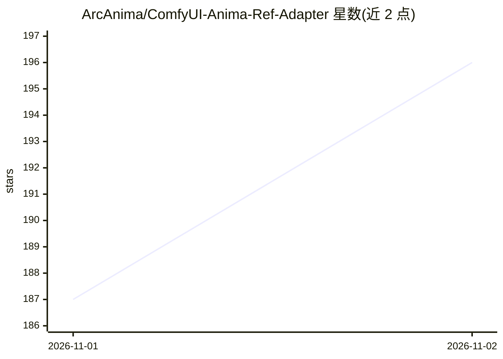

# ArcAnima/ComfyUI-Anima-Ref-Adapter

⭐ 196 · Python · Apache-2.0 · 推送 2026-10-31 · [GitHub](https://github.com/ArcAnima/ComfyUI-Anima-Ref-Adapter) · 个人维护 · 中文 README

**ComfyUI 节点+LoRA：让 Anima 模型按参考图保持角色与画风生成图像**

面向 ComfyUI 用户与 Anima 文生图模型的自定义节点：提供单节点 Anima Ref Adapter，接收参考图与场景提示词，通过偏移 RoPE 参考帧与 rank-64 LoRA 保持角色身份（发型、瞳色、服饰）与部分画风，姿势与构图由提示词控制；支持两张参考图拼接生成双角色。参考流仅自注意力且每图编码一次，v2 较 pilot 提速约 2 倍。安装方式为 git clone 到 custom_nodes，权重（183 MB）首次运行时自动从 Hugging Face 下载。注意：开发因资金暂停，后续训练不再进行。

## 筛选速览

| 维度 | 判定 | 备注 |
|---|---|---|
| AI 角色 | `ai-native` | 本体是模型或模型工具 |
| 许可风险 | `permissive` | Apache-2.0 |
| 部署形态 | `None` |  |
| 模型依赖 | — | README 未给出锁定关系 |
| 硬件要求 | — | 无带数字的原话,不猜 |
| 安装摩擦 | `low` | 无编译、无系统依赖或容器化 |
| 成熟度 | — | 结构信号不足 |

## 能力要点

- 单节点接入标准 Anima 工作流，兼容 KSampler 等任意采样器
- 偏移 RoPE 参考帧 + rank-64 LoRA 实现角色与风格迁移（15,600 图/2,300 角色/1,952 画风训练）
- 双参考图拼接生成同图双角色
- v2 每步采样约 0.28 s（RTX PRO 6000），较 pilot 提速约 2 倍

## 适用场景

- 用原创角色参考图在不同场景中生成同角色图像
- 无需角色名/画师标签即可复现角色外观
- 两张参考图生成双角色同框图像

## 场景标签

`图像生成` · 领域:内容生成

## 证据(README 行号)

> L17: Give Anima one reference image and a prompt that describes
> L119: |**Anima Ref Adapter**|The one to use. `MODEL` + `VAE` + reference `IMAGE` + adapter LoRA -> `MODEL` for any sampl
> L150: - A **rank-64 LoRA**, active only with the reference, learns to read it. Training pairs are the same character

## 星数曲线

2026-11-01 187 → 2026-11-02 196（+9）

---
*卡片 v1 · prompt 1.4 · 生成 2026-10-31 · 置信度 high · 依据 README sha `b304df82eadf` · [字段定义](../../DATASET.md)*
