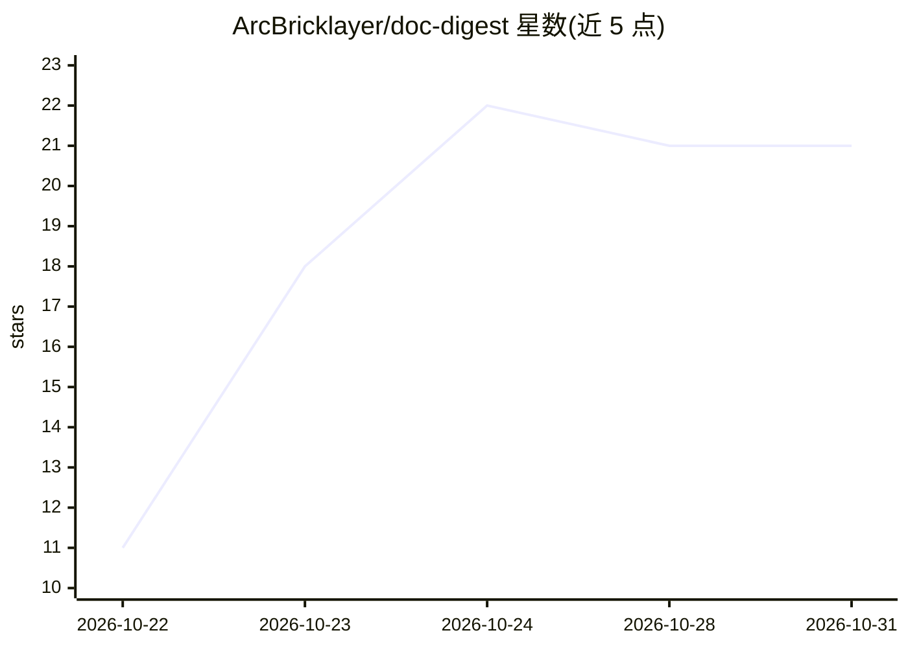

# ArcBricklayer/doc-digest

⭐ 21 · C# · MIT · 推送 2026-10-18 · [GitHub](https://github.com/ArcBricklayer/doc-digest) · 个人维护

**Windows 本地 PDF 长文摘要与带引文问答工具**

面向 Windows 10/11 用户的离线文档摘要工具：以 map-reduce 分段方式处理最长约 500 页的 PDF，生成分章大纲、要点卡片，并提供带页码引文的问答与引语查找，支持整文件夹批量输出 markdown 摘要。100 MB 自包含便携 exe，运行时内置，模型需另行下载，此后完全离线，无广告、无账号、无遥测。也可用 .NET 8 SDK 从源码构建。

## 筛选速览

| 维度 | 判定 | 备注 |
|---|---|---|
| AI 角色 | `ai-native` | 本体是模型或模型工具 |
| 许可风险 | `permissive` | MIT |
| 部署形态 | `None` |  |
| 模型依赖 | — | README 未给出锁定关系 |
| 硬件要求 | — | 无带数字的原话,不猜 |
| 安装摩擦 | `medium` | 含编译或系统依赖之一 |
| 成熟度 | — | 结构信号不足 |

## 能力要点

- map-reduce 分段处理 500 页级长 PDF
- 问答答案附带页码引文并可跳转原文
- 文件夹批量摘要，逐文件输出 markdown
- 100 MB 自包含便携 exe，离线运行，MIT 许可

## 适用场景

- 不出上传保密合同或内部报告，本地生成摘要
- 就长 PDF 内容提问并获得可核对的页码出处
- 批量把一文件夹报告各自摘要成 markdown

## 场景标签

`文档问答` · 领域:知识与检索

## 证据(README 行号)

> L3: 📖 Free, open-source document summarizer for Windows — long PDFs into digests and Q&A with local LLMs. 100 MB portabl
> L11: - ✅ **Long-document handling** — map-reduce passes digest 500-page PDFs that would blow a single context window
> L14: - ✅ **Q&A with citations** — ask about the document and every answer links to the page it came from

## 星数曲线

2026-10-22 11 → 2026-10-31 21（+10）

---
*卡片 v1 · prompt 1.4 · 生成 2026-10-28 · 置信度 high · 依据 README sha `238acd23dbd2` · [字段定义](../../DATASET.md)*
