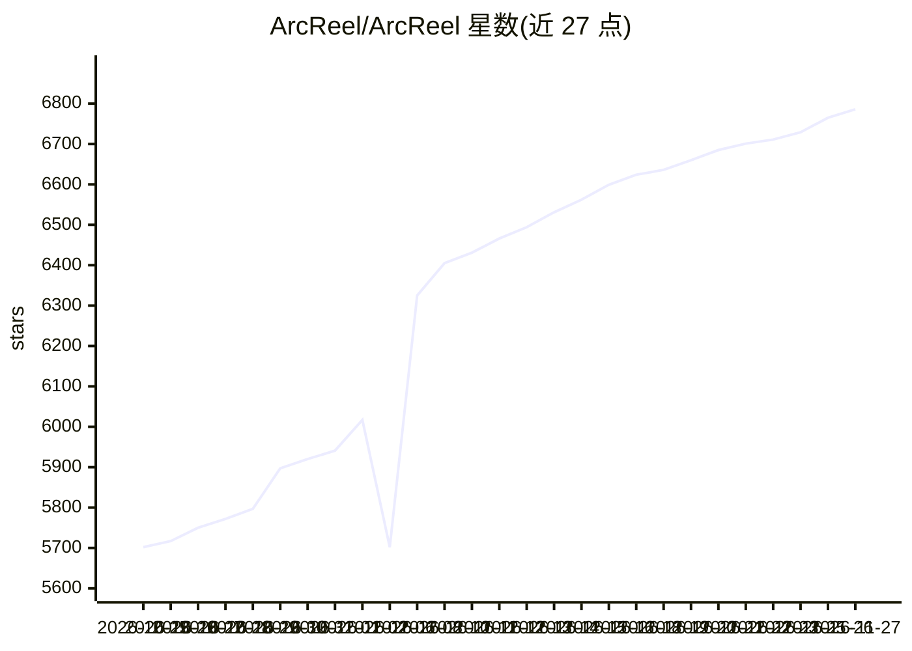

# ArcReel/ArcReel

⭐ 6,786 · Python · AGPL-3.0 · 推送 2026-11-26 · [GitHub](https://github.com/ArcReel/ArcReel) · [官网](https://arc-reel.com) · 个人维护 · 中文 README

**自部署 AI 视频工作台：小说剧本转分镜视频与剪映草稿**

ArcReel 是开源、自托管的 AI 视频生产工作台，支持旁白/解说、剧情演绎和广告/短片三类项目：将小说、剧本或商品素材经脚本规划、分镜、图生视频/参考生视频，生成角色一致、可跨镜头复用参考素材的成片，并可导出草稿交给中国大陆版剪映继续编辑。创作者可让 Agent 编排制作，也可在工作台逐阶段审核、修改或重新生成；按项目配置文本、图像、视频和配音能力，提供生成前费用预估与调用后用量追踪。通过 Docker Compose 自部署，浏览器访问本地端口使用。CapCut 兼容性尚未验证。

## 筛选速览

| 维度 | 判定 | 备注 |
|---|---|---|
| AI 角色 | `ai-native` | 本体是模型或模型工具 |
| 许可风险 | `viral` | AGPL-3.0 |
| 部署形态 | `self-host` | docker 或自建部署 |
| 模型依赖 | — | README 未给出锁定关系 |
| 硬件要求 | — | 无带数字的原话,不猜 |
| 安装摩擦 | `low` | 无编译、无系统依赖或容器化 |
| 成熟度 | — | 结构信号不足 |

## 能力要点

- Agent 编排与工作台人工审核结合的制作流程
- 跨镜头复用角色、场景、道具参考素材，保留生成历史可对比回滚
- 生成前费用预估与调用后实际用量追踪，多供应商按项目配置
- 导出中国大陆版剪映草稿继续编辑

## 适用场景

- 把小说或成品剧本批量制作成剧情短视频
- 制作广告/带货短片并管理生成成本
- 生成后导入剪映做进一步人工剪辑

## 场景标签

`视频生成` · 领域:内容生成

## 证据(README 行号)

> L7:  将小说、成品剧本或商品素材转化为角色一致、过程可控、成本可追踪且可继续编辑的短视频。
> L68: ArcReel 支持旁白/解说、剧情演绎和广告/短片。创作者可以让 Agent 编排制作，也可以在工作台审核、修改或重新生成各阶段的内容。
> L71: - 按项目配置文本、图像、视频和配音能力，查看生成前的费用预估与调用后的实际用量。

## 星数曲线

2026-10-25 5,702 → 2026-11-27 6,786（+1,084）

---
*卡片 v1 · prompt 1.4 · 生成 2026-11-27 · 置信度 high · 依据 README sha `fd8ad51cc63e` · [字段定义](../../DATASET.md)*
