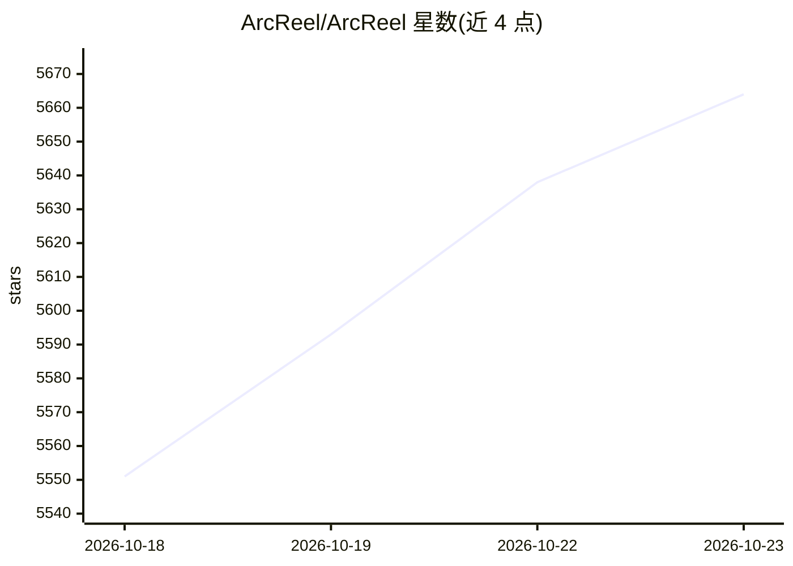

# ArcReel/ArcReel

⭐ 5,664 · Python · AGPL-3.0 · 推送 2026-10-22 · [GitHub](https://github.com/ArcReel/ArcReel) · [官网](https://arc-reel.com) · 组织维护 · 中文 README

**自托管 AI 视频生产工作台：小说/剧本转角色一致短视频**

面向 AI 漫剧与小说改编、解说短视频、广告带货短片的开源自托管工作台，将内容分析、角色/场景/道具资产管理、分镜、媒体生成、费用追踪与导出组织为可审核、可中断恢复的生产流水线。每个阶段可由 Agent 编排或用户手动审核，支持跨分镜资产复用以保持视觉一致性，统一配置文本/图像/视频/TTS 供应商并追踪费用。既可直接合成视频，也可导出剪映草稿继续编辑（面向中国大陆版剪映，与 CapCut 兼容性未验证）。通过 Docker Compose 部署，AGPL-3.0 许可并附商业授权联系渠道。

## 筛选速览

| 维度 | 判定 | 备注 |
|---|---|---|
| AI 角色 | `ai-native` | 本体是模型或模型工具 |
| 许可风险 | `viral` | AGPL-3.0 |
| 部署形态 | `self-host` | docker 或自建部署 |
| 模型依赖 | — | README 未给出锁定关系 |
| 硬件要求 | — | 无带数字的原话,不猜 |
| 安装摩擦 | `low` | 无编译、无系统依赖或容器化 |
| 成熟度 | — | 结构信号不足 |

## 能力要点

- 小说/剧本/商品素材到角色、分镜、成片的统一生产流水线
- 跨分镜资产复用保持视觉一致，关键阶段可确认、素材可重做、版本可回滚
- 统一配置文本/图像/视频/TTS 供应商，生成前后查看费用与用量
- 可导出剪映草稿继续编辑字幕、配音、节奏与转场

## 适用场景

- 把网文小说改编成角色一致的短视频剧集
- 制作商品带货短片并追踪各模型生成费用
- 在剪映中继续精修 AI 生成的视频草稿

## 场景标签

`视频生成` `图像生成` · 领域:内容生成

## 证据(README 行号)

> L7:  将小说、成品剧本或商品素材转化为角色一致、过程可控、成本可追踪、可继续编辑的短视频。
> L75: ArcReel 是面向 AI 漫剧与小说改编、旁白/解说短视频、广告与带货短片的开源自托管工作台。它把内容分析、资产管理、分镜、媒体生成、费用追踪和导出组织成一条可审核、可中断恢复的生产流水线。

## 星数曲线

2026-10-18 5,551 → 2026-10-23 5,664（+113）

---
*卡片 v1 · prompt 1.4 · 生成 2026-10-20 · 置信度 high · 依据 README sha `324ad688ef0f` · [字段定义](../../DATASET.md)*
