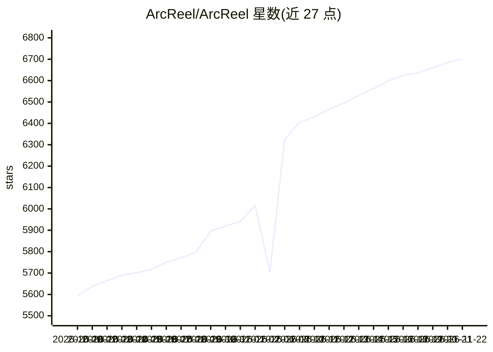

# ArcReel/ArcReel

⭐ 6,701 · Python · AGPL-3.0 · 推送 2026-11-21 · [GitHub](https://github.com/ArcReel/ArcReel) · [官网](https://arc-reel.com) · 组织维护 · 中文 README

**给创作者把小说剧本转为短视频的自部署 AI 工作台**

自托管的 AI 视频生产工作台，将小说、成品剧本或商品素材转化为角色、场景、道具资产、分镜、视频和剪映草稿。Agent 可编排制作，用户在工作台审核、修改或重新生成各阶段内容；支持跨镜头复用参考素材、按项目配置文本/图像/视频/配音能力，并提供生成前费用预估与调用后用量追踪。Docker Compose 部署，导出兼容中国大陆版剪映（CapCut 未验证）。

## 筛选速览

| 维度 | 判定 | 备注 |
|---|---|---|
| AI 角色 | `ai-native` | 本体是模型或模型工具 |
| 许可风险 | `viral` | AGPL-3.0 |
| 部署形态 | `self-host` | docker 或自建部署 |
| 模型依赖 | — | README 未给出锁定关系 |
| 硬件要求 | — | 无带数字的原话,不猜 |
| 安装摩擦 | `low` | 无编译、无系统依赖或容器化 |
| 成熟度 | — | 结构信号不足 |

## 能力要点

- 小说/剧本→资产、分镜、视频、剪映草稿的完整流程
- 跨镜头复用角色/场景/道具参考素材，保留生成历史可回滚
- 按项目配置多供应商生成能力，含费用预估与用量追踪
- Docker Compose 自部署，Web 工作台操作

## 适用场景

- 把小说章节批量转成短剧视频
- 制作广告/带货短片并导出到剪映继续剪辑
- 团队自托管平台统一管理视频生成成本

## 场景标签

`视频生成` · 领域:内容生成

## 证据(README 行号)

> L5:  开源、自托管的 AI 视频生产工作台
> L7:  将小说、成品剧本或商品素材转化为角色一致、过程可控、成本可追踪且可继续编辑的短视频。
> L74: ArcReel 支持旁白/解说、剧情演绎和广告/短片。创作者可以让 Agent 编排制作，也可以在工作台审核、修改或重新生成各阶段的内容。

## 星数曲线

2026-10-20 5,593 → 2026-11-22 6,701（+1,108）

---
*卡片 v1 · prompt 1.4 · 生成 2026-11-22 · 置信度 high · 依据 README sha `8134b807d9e7` · [字段定义](../../DATASET.md)*
