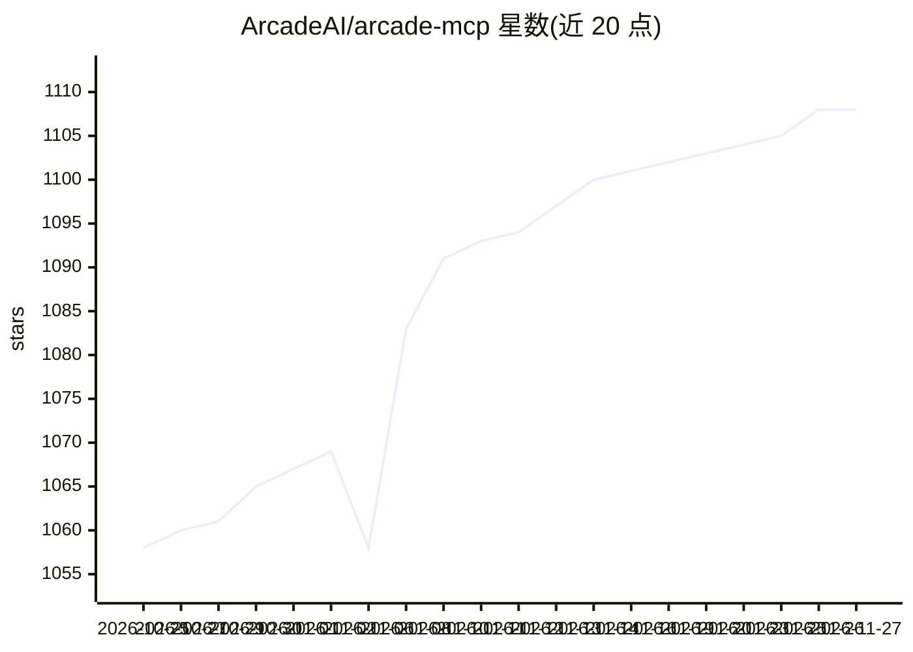

# ArcadeAI/arcade-mcp

⭐ 1,108 · Python · MIT · 推送 2026-11-25 · [GitHub](https://github.com/ArcadeAI/arcade-mcp) · [官网](https://docs.arcade.dev) · 组织维护

**面向开发者的 Python 框架：构建 MCP 服务器与 agent 工具**

arcade-mcp 是构建 Model Context Protocol 服务器及其内部工具的 Python 框架，也是 Arcade.dev 上 7,500+ 预构建工具、81 个 MCP 服务器的底层实现。通过装饰器 API 覆盖 MCP 完整规范（tools/resources/prompts/sampling/elicitation），支持声明式授权（框架代管 OAuth、令牌刷新与按调用授权，客户端与 LLM 不接触密钥），附带 arcade evals 工具调用评测与 arcade deploy 云部署命令。提供 CLI 脚手架、stdio/HTTP 两种传输，适配 Claude Desktop、Cursor、VS Code 等 MCP 客户端。

## 筛选速览

| 维度 | 判定 | 备注 |
|---|---|---|
| AI 角色 | `ai-ecosystem` | LLM/agent 周边工具 |
| 许可风险 | `permissive` | MIT |
| 部署形态 | `library` | 以包/库形式分发 |
| 模型依赖 | — | README 未给出锁定关系 |
| 硬件要求 | — | 无带数字的原话,不猜 |
| 安装摩擦 | `medium` | 含编译或系统依赖之一 |
| 成熟度 | — | 结构信号不足 |

## 能力要点

- 装饰器 API 覆盖 MCP 完整规范（tools、resources、prompts、sampling、elicitation 等）
- 声明式授权：OAuth、令牌刷新与按调用授权由框架托管，客户端与 LLM 不接触密钥
- 内嵌 23 个流行服务商的 OAuth 授权辅助类
- arcade evals 支持对真实 LLM 进行工具调用准确性测试

## 适用场景

- 为内部 API 或自定义 OAuth 服务商构建 MCP 工具接入 agent
- 开发需要安全密钥管理的授权工具调用
- 将自建 MCP 服务器一键部署到云端托管

## 场景标签

`模型评测` `Agent 框架` · 领域:Agent 开发

## 证据(README 行号)

> L10: **Open-source Python framework for building MCP servers and tools.**
> L16: `arcade-mcp` is the Python framework for building Model Context Protocol servers and the tools that run inside them
> L24: - Vendor-neutral. Any MCP client, any LLM, any agent framework (LangChain, Mastra, Pydantic AI, CrewAI, Google ADK,

## 星数曲线

2026-10-25 1,058 → 2026-11-27 1,108（+50）

---
*卡片 v1 · prompt 1.4 · 生成 2026-11-24 · 置信度 high · 依据 README sha `638877282b94` · [字段定义](../../DATASET.md)*
