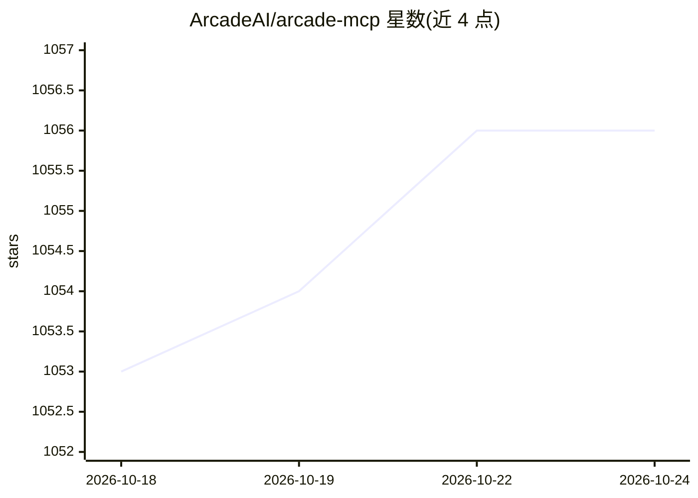

# ArcadeAI/arcade-mcp

⭐ 1,056 · Python · MIT · 推送 2026-10-23 · [GitHub](https://github.com/ArcadeAI/arcade-mcp) · [官网](https://docs.arcade.dev) · 组织维护

**Python 框架：构建 MCP 服务器与授权工具调用**

构建 Model Context Protocol 服务器与工具的开源 Python 框架，为 Arcade.dev 的 7,500+ 预构建工具与 81 个 MCP 服务器提供底层支撑。提供装饰器 API 覆盖完整 MCP 规范（工具/资源/提示/采样等），支持授权工具调用：声明 OAuth 作用域后由框架处理授权、令牌存储与刷新，客户端与 LLM 不接触令牌。附 23 个主流服务商的 OAuth 辅助类，兼容任意 MCP 客户端与主流 agent 框架，提供 CLI 脚手架、evals 测试与 Arcade Cloud 一键部署，也可独立运行。

## 筛选速览

| 维度 | 判定 | 备注 |
|---|---|---|
| AI 角色 | `ai-ecosystem` | LLM/agent 周边工具 |
| 许可风险 | `permissive` | MIT |
| 部署形态 | `library` | 以包/库形式分发 |
| 模型依赖 | — | README 未给出锁定关系 |
| 硬件要求 | — | 无带数字的原话,不猜 |
| 安装摩擦 | `medium` | 含编译或系统依赖之一 |
| 成熟度 | — | 结构信号不足 |

## 能力要点

- 装饰器 API 覆盖完整 MCP 规范（工具/资源/提示/采样/进度等）
- 授权工具调用：框架托管 OAuth 令牌，客户端与 LLM 不可见
- 23 个服务商 OAuth 辅助类（GitHub/Slack/Notion 等）
- `arcade evals` 工具调用准确率测试与 `arcade deploy` 云端部署

## 适用场景

- 为内部 API 或自定义 OAuth 服务商开发 MCP 工具
- 让 agent 安全调用需要授权的上游 API
- 测试 MCP 工具在真实 LLM 下的调用准确性

## 场景标签

`Agent 框架` `模型评测` · 领域:Agent 开发

## 证据(README 行号)

> L10: **Open-source Python framework for building MCP servers and tools.**
> L16: `arcade-mcp` is the Python framework for building Model Context Protocol servers and the tools that run inside them

## 星数曲线

2026-10-18 1,053 → 2026-10-24 1,056（+3）

---
*卡片 v1 · prompt 1.4 · 生成 2026-10-21 · 置信度 high · 依据 README sha `5223dcd72061` · [字段定义](../../DATASET.md)*
