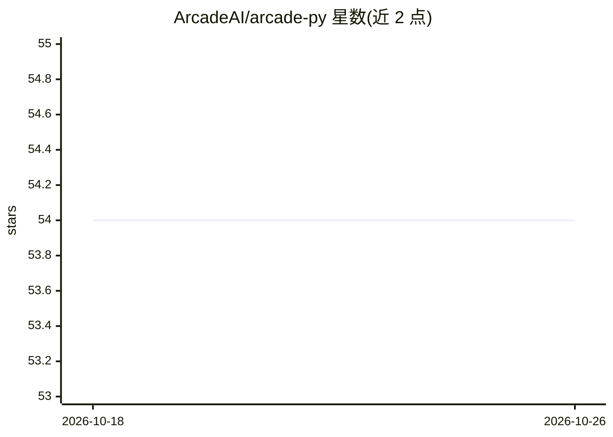

# ArcadeAI/arcade-py

⭐ 54 · Python · MIT · 推送 2026-09-10 · [GitHub](https://github.com/ArcadeAI/arcade-py) · [官网](https://docs.arcade.dev) · 组织维护

**Arcade 平台的官方 Python API 客户端，供 Python 3.8+ 应用调用其 REST API**

由 ArcadeAI 官方维护、经 Stainless 生成的 Python SDK，封装对 Arcade REST API 的访问：提供同步与异步客户端（默认基于 httpx，可选 aiohttp 后端）、全量请求参数与响应字段的类型定义（TypedDict 请求、Pydantic 响应模型）、自动重试（默认 2 次、指数退避）、超时与 HTTP 客户端定制、流式响应及未文档化端点的访问。面向在 Python 应用中接入 Arcade 平台的开发者，需 API key 认证。文档位于 docs.arcade.dev。

## 筛选速览

| 维度 | 判定 | 备注 |
|---|---|---|
| AI 角色 | `ai-ecosystem` | LLM/agent 周边工具 |
| 许可风险 | `permissive` | MIT |
| 部署形态 | `library` | 以包/库形式分发 |
| 模型依赖 | — | README 未给出锁定关系 |
| 硬件要求 | — | 无带数字的原话,不猜 |
| 安装摩擦 | `low` | 无编译、无系统依赖或容器化 |
| 成熟度 | — | 结构信号不足 |

## 能力要点

- 同步/异步双客户端，默认 httpx，可选 aiohttp 后端
- 全量类型定义：TypedDict 请求参数与 Pydantic 响应模型
- 连接错误、408/409/429/5xx 自动重试（默认 2 次，指数退避）
- 支持流式响应、代理/自定义 transport 及未文档化端点访问

## 适用场景

- 在 Python 应用中调用 Arcade REST API
- 构建异步高并发的 Arcade API 集成
- 通过类型提示在 IDE 中获得自动补全与文档

## 场景标签

 · 领域:LLM 基础设施/API 客户端

## 证据(README 行号)

> L5: The Arcade Python library provides convenient access to the Arcade REST API from any Python 3.8+
> L9: It is generated with Stainless.

## 星数曲线

2026-10-18 54 → 2026-10-26 54（+0）

---
*卡片 v1 · prompt 1.4 · 生成 2026-10-24 · 置信度 mid · 依据 README sha `ec0d2bd5a0d1` · [字段定义](../../DATASET.md)*
