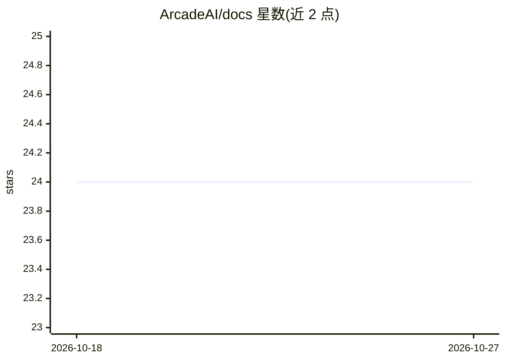

# ArcadeAI/docs

⭐ — · [GitHub]() · 组织维护

**Arcade AI 产品的官方文档站点仓库（Next.js/Fumadocs）**

Arcade AI 官方文档的源码仓库：基于 Next.js 与 Fumadocs 构建，内容为 content/docs/ 下的 MDX 文件，由各目录 meta.json 控制侧边栏结构。面向文档贡献者与维护者，提供 bun 驱动的本地开发命令（install/dev/build/lint/typecheck/test）。含 Vale 风格检查与基于 LLM 的自动 PR 审查（Style Review 与 Editorial Review），并从全部页面生成 public/llms.txt；Toolkit（MCP server）参考页由 JSON 数据经生成器产出而非 MDX。

## 筛选速览

| 维度 | 判定 | 备注 |
|---|---|---|
| AI 角色 | `ai-knowledge` | 知识聚合/清单类 |
| 许可风险 | `none` | — |
| 部署形态 | `None` |  |
| 模型依赖 | — | README 未给出锁定关系 |
| 硬件要求 | — | 无带数字的原话,不猜 |
| 安装摩擦 | `low` | 无编译、无系统依赖或容器化 |
| 成熟度 | — | 结构信号不足 |

## 能力要点

- MDX 内容 + meta.json 侧边栏组织的文档站点
- Vale 风格检查与 LLM 驱动的自动 PR 审查（需 API key）
- scripts/generate-llmstxt.ts 按 llms.txt 规范从全部页面生成 llms.txt
- Toolkit（MCP server）参考页由 toolkit-docs-generator 从 JSON 数据生成

## 适用场景

- 参与 Arcade 文档的撰写与本地预览
- 了解 Arcade Toolkit（MCP server）参考文档的生成流程
- 为文档项目参考其 llms.txt 生成与 LLM 自动审查机制

## 场景标签

 · 领域:开发者文档/AI 工具生态

## 证据(README 行号)

> L1: # Arcade Documentation
> L3: Documentation for Arcade, built with Next.js and Fumadocs. Content is MDX under `content/docs/`.
> L96: Toolkit reference pages at `/en/resources/integrations/<category>/<toolkit>` are generated from `toolkit-docs-gener

## 星数曲线

2026-10-18 24 → 2026-10-27 24（+0）

---
*卡片 v1 · prompt 1.4 · 生成 2026-10-27 · 置信度 high · 依据 README sha `f80e5254bd9f` · [字段定义](../../DATASET.md)*
