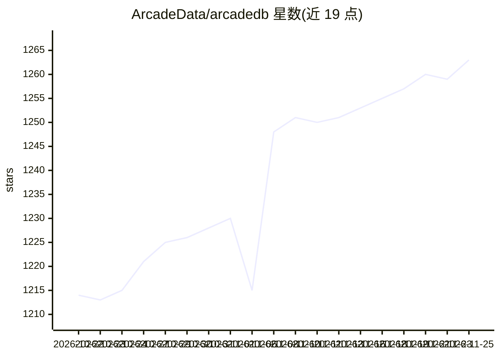

# ArcadeData/arcadedb

⭐ 1,263 · Java · Apache-2.0 · 推送 2026-11-23 · [GitHub](https://github.com/ArcadeData/arcadedb) · [官网](https://arcadedb.com) · 组织维护

**面向多模型数据场景的多模型 DBMS：一库支持图/文档/向量等**

由 OrientDB 创始人创建的多模型 DBMS，单引擎支持图、文档、键值、搜索引擎、时间序列、向量嵌入与地理空间等模型，兼容 SQL、Cypher、Gremlin、MongoDB、Redis、Postgres Wire 等协议与查询语言。可作为 JVM 内嵌库（含 Python 绑定）、独立服务器或 Docker 容器运行，支持 ACID 事务、Raft 高可用与 Kubernetes 部署。内置 MCP Server 与 Studio 中的 AI 助手（Beta）供 AI 助手访问数据库；发布分 full/minimal/headless/base 四种包变体。

## 筛选速览

| 维度 | 判定 | 备注 |
|---|---|---|
| AI 角色 | `ai-enhanced` | 去掉 AI 部分产品仍成立 |
| 许可风险 | `permissive` | Apache-2.0 |
| 部署形态 | `self-host` | docker 或自建部署 |
| 模型依赖 | — | README 未给出锁定关系 |
| 硬件要求 | — | 无带数字的原话,不猜 |
| 安装摩擦 | `low` | 无编译、无系统依赖或容器化 |
| 成熟度 | — | 结构信号不足 |

## 能力要点

- 单库支持图/文档/键值/时序/向量/地理空间等多种模型
- 兼容 Cypher、Gremlin、MongoDB、Redis、Postgres Wire 等多协议
- 内置 MCP Server 供 AI 助手接入（含 Claude Code 插件）
- 70+ 内置图算法与物化视图、并行查询执行

## 适用场景

- 用图+向量+时序组合构建推荐引擎
- 用单库替代多套图/文档/键值数据库的运维
- 让 AI 助手通过 MCP Server 查询管理数据库
- 基于 Graph RAG 与 LangChain4j 做检索增强生成

## 场景标签

`RAG` `向量数据库` · 领域:知识与检索

## 证据(README 行号)

> L75: ArcadeDB is a Multi-Model DBMS created by Luca Garulli, the same founder
> L95: - Vector Embedding
> L112: - **MCP Server** — Built-in Model Context Protocol server for AI assistant and LLM

## 星数曲线

2026-10-22 1,214 → 2026-11-25 1,263（+49）

---
*卡片 v1 · prompt 1.4 · 生成 2026-11-23 · 置信度 mid · 依据 README sha `92784d225bd1` · [字段定义](../../DATASET.md)*
