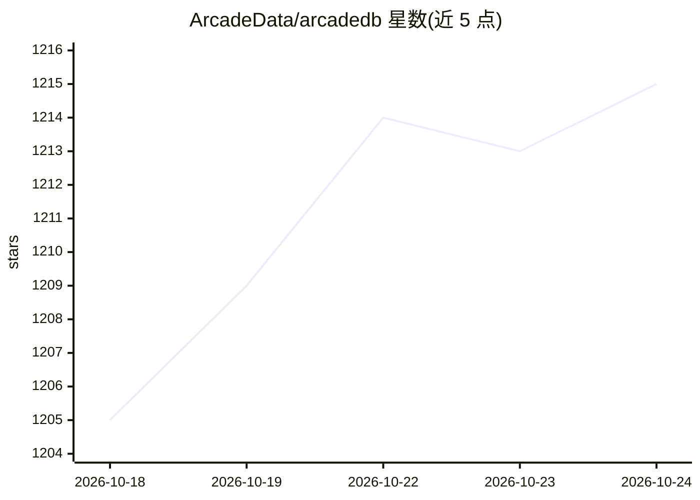

# ArcadeData/arcadedb

⭐ 1,215 · Java · Apache-2.0 · 推送 2026-10-24 · [GitHub](https://github.com/ArcadeData/arcadedb) · [官网](https://arcadedb.com) · 组织维护

**面向开发者的多模型数据库：图/文档/KV/向量/时序一体化 DBMS**

由 OrientDB 创始人创建的多模型 DBMS，单一引擎支持图、文档、键值、搜索、时序、向量嵌入与地理空间模型，兼容 Cypher、Gremlin、SQL、MongoDB/Redis 驱动协议及 Postgres Wire 协议。提供 ACID 事务、70+ 内置图算法、并行查询、物化视图、内置 MCP Server 供 AI 助手接入，Studio 中含 Beta 版 AI 助手。可 Docker 部署、Kubernetes 运行或嵌入 JVM/Python；源码以 Java 21+ 编写，非 Docker 部署需 JDK，另提供 GraalVM native-image 实验构建。

## 筛选速览

| 维度 | 判定 | 备注 |
|---|---|---|
| AI 角色 | `ai-enhanced` | 去掉 AI 部分产品仍成立 |
| 许可风险 | `permissive` | Apache-2.0 |
| 部署形态 | `self-host` | docker 或自建部署 |
| 模型依赖 | — | README 未给出锁定关系 |
| 硬件要求 | — | 无带数字的原话,不猜 |
| 安装摩擦 | `low` | 无编译、无系统依赖或容器化 |
| 成熟度 | `idea` | |

## 能力要点

- 单引擎支持图/文档/KV/向量嵌入/时序/地理空间多模型
- 内置 MCP Server 供 AI 助手与 LLM 接入
- 兼容 Neo4j Cypher、Gremlin、MongoDB/Redis/Postgres 驱动协议
- 四档发行包与自定义模块构建器（含 GraalVM native-image 实验构建）

## 适用场景

- 用一套数据库承载图遍历、向量相似度与时序的推荐/风控场景
- 通过内置 MCP Server 让 AI 助手查询和管理数据库
- 构建 Graph RAG 或知识图谱应用（官方用例库提供示例）

## 场景标签

`知识图谱` `向量数据库` · 领域:知识与检索

## 证据(README 行号)

> L111: - **MCP Server** — Built-in Model Context Protocol server for AI assistant and LLM
> L94: - Vector Embedding
> L129: - By AI assistants via the built-in MCP Server (Model Context Protocol)

## 星数曲线

2026-10-18 1,205 → 2026-10-24 1,215（+10）

---
*卡片 v1 · prompt 1.4 · 生成 2026-10-21 · 置信度 mid · 依据 README sha `458c22735d6d` · [字段定义](../../DATASET.md)*
