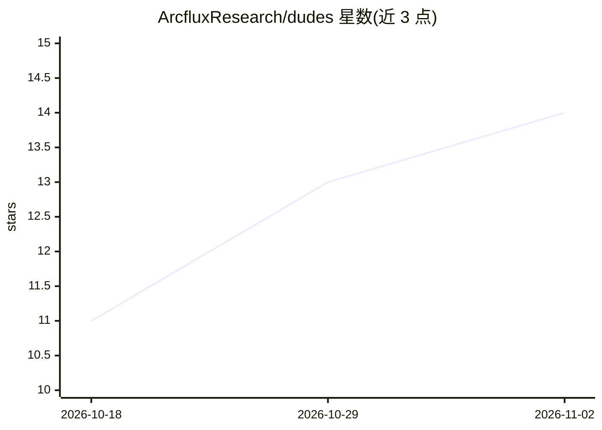

# ArcfluxResearch/dudes

⭐ 14 · Rust · Apache-2.0 · 推送 2026-11-01 · [GitHub](https://github.com/ArcfluxResearch/dudes) · 组织维护

**面向开发者的多编码 agent 编排守护进程，目标需通过自检才算完成**

Rust 编写的守护进程与 CLI，用于驱动 Claude Code、Codex、Pi 等编码 agent 持续工作：为每个 agent 指派角色、目标与完成检查，守护进程自行运行检查，通过前不停止工作循环。提供浏览器内的 3D 办公室视图（Floor）与看板（Board）用于分配工单与审查结果；支持可选的支出预算限制、进程生命周期管理（agent 或 daemon 结束时终止进程）及 MCP 工具接入。macOS/Linux 通过 curl 安装脚本安装，Windows 与源码构建需另行编译。自述声明为早期预览版，命令与配置项可能随版本变更；agent 以用户本机账户运行。

## 筛选速览

| 维度 | 判定 | 备注 |
|---|---|---|
| AI 角色 | `ai-ecosystem` | LLM/agent 周边工具 |
| 许可风险 | `permissive` | Apache-2.0 |
| 部署形态 | `None` |  |
| 模型依赖 | — | README 未给出锁定关系 |
| 硬件要求 | — | 无带数字的原话,不猜 |
| 安装摩擦 | `low` | 无编译、无系统依赖或容器化 |
| 成熟度 | `idea` | |

## 能力要点

- 目标仅在守护进程自身运行完成检查通过后才标记 Done
- 驱动 Claude Code、Codex、Pi 三种 CLI agent，各配角色与完成检查
- 浏览器 3D 办公室视图（8/12/16 agent 布局）与工单看板
- 可选支出预算限制与 agent 进程生命周期管理，支持 MCP 工具接入

## 适用场景

- 让多个编码 agent 在自己仓库里持续完成带验收条件的任务
- 通过 3D 界面与看板分配工单并审查 agent 产出
- 离线无账户运行示例验证完整目标闭环（examples/two-roles）

## 场景标签

`编码 Agent` `多智能体` · 领域:Agent 开发

## 证据(README 行号)

> L7: Dudes keeps your coding agents working on goals you can check. Hire Claude Code, Codex, or Pi,
> L44: - A goal is Done only when its completion check passes in the daemon's own run.

## 星数曲线

2026-10-18 11 → 2026-11-02 14（+3）

---
*卡片 v1 · prompt 1.4 · 生成 2026-10-31 · 置信度 high · 依据 README sha `304b5dae6cfb` · [字段定义](../../DATASET.md)*
