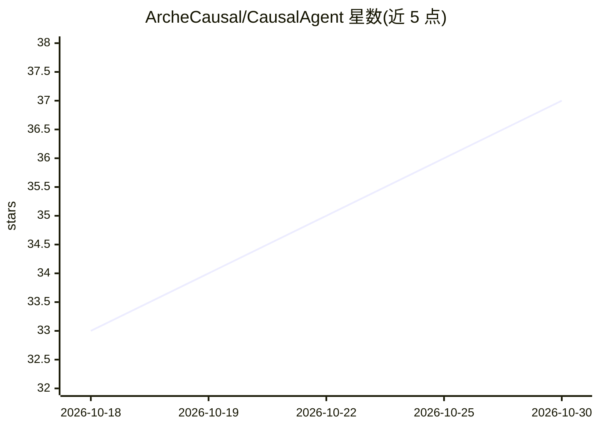

# ArcheCausal/CausalAgent

⭐ 37 · Python · AGPL-3.0 · 推送 2026-10-29 · [GitHub](https://github.com/ArcheCausal/CausalAgent) · 组织维护 · 中文 README

**面向表格数据的因果分析多智能体应用，产出报告与因果图**

CausalAgent 是面向表格数据的因果分析 Web 应用：用户上传数据后，由 LangGraph 父图编排预处理、Deep Agent 子图、算法工具调用与报告生成，输出交互式因果图和结构化分析报告。算法以 MCP 工具解耦，默认支持 PC、DirectLiNGAM 与 CDFM；RAG 检索因果推断文献知识库（ChromaDB+BM25S），SearXNG 聚合学术搜索；后处理含环路检测与边评估。README 声明仍在开发中，结论受数据质量与方法假设限制。部署方式为 Docker Compose，需自行配置模型与 Embedding API，含管理员后台、RAG 评测工作台与 Grafana 日志链路。

## 筛选速览

| 维度 | 判定 | 备注 |
|---|---|---|
| AI 角色 | `ai-native` | 本体是模型或模型工具 |
| 许可风险 | `viral` | AGPL-3.0 |
| 部署形态 | `desktop` | 安装包/桌面程序 |
| 模型依赖 | — | README 未给出锁定关系 |
| 硬件要求 | — | 无带数字的原话,不猜 |
| 安装摩擦 | `low` | 无编译、无系统依赖或容器化 |
| 成熟度 | `idea` | |

## 能力要点

- LangGraph 父图 + Deep Agent 子图编排因果分析流程，独立 worker 执行 Job
- MCP 可插拔算法框架，默认支持 PC、DirectLiNGAM、CDFM 三种因果发现算法
- ChromaDB+BM25S 混合检索的因果推断知识库与受控 release 机制
- 交互式因果图（vis-network）与结构化报告生成

## 适用场景

- 上传表格数据后自动完成预处理、因果结构学习并获得分析报告
- 探索数据中的因果结构，配合文献检索辅助理解
- 管理员在隔离评测工作台构建与评测 RAG 知识库

## 场景标签

`多智能体` `RAG` `数据分析` · 领域:Agent 开发

## 证据(README 行号)

> L40: **新一代因果分析智能体**：CausalAgent 是面向表格数据的因果分析应用。LangGraph 父图负责编排预处理、Deep Agent 子图、工具调用和报告生成；分析任务由独立 worker 执行。
> L69: CausalAgent 的整体因果分析流程可以抽象为：**用户上传数据 → 预处理与数据体检 → 因果结构学习 → 后处理与质量提升 → 报告与可视化输出**。下面按模块进行说明。
> L141: - **自动生成结构化报告**：围绕「分析背景 → 数据概况 → 方法说明 → 因果发现 → 结论与建议 → 局限性」等章节自动撰写自然语言报告。

## 星数曲线

2026-10-18 33 → 2026-10-30 37（+4）

---
*卡片 v1 · prompt 1.4 · 生成 2026-10-25 · 置信度 mid · 依据 README sha `f65735c6a2a2` · [字段定义](../../DATASET.md)*
