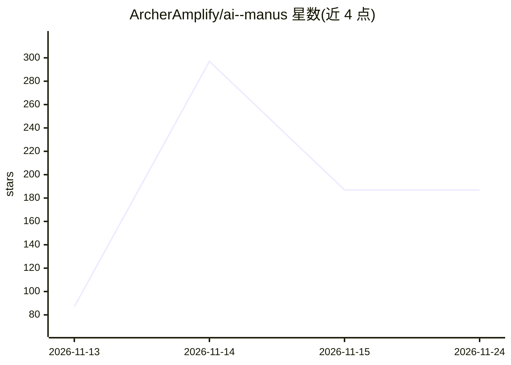

# ArcherAmplify/ai--manus

⭐ 187 · Apache-2.0 · 推送 2026-11-15 · [GitHub](https://github.com/ArcherAmplify/ai--manus) · 个人维护

**面向日常任务的自主 AI Agent：代用户执行代码与控制浏览器**

Manus 是一个自主 AI Agent 系统，在沙箱环境中运行各类工具：可自行编写并执行脚本、控制浏览器（导航网页、填写表单、采集信息）、执行多步骤任务。定位为个人助手，面向学习、家庭项目与轻量办公等小规模场景，非企业平台。README 声明兼容 64 位系统、4 GB 内存起步、推荐 8 GB。提供下载入口（PROMO2026），但未给出具体安装命令、技术架构或源码构建说明，README 以功能描述为主。

## 筛选速览

| 维度 | 判定 | 备注 |
|---|---|---|
| AI 角色 | `ai-native` | 本体是模型或模型工具 |
| 许可风险 | `permissive` | Apache-2.0 |
| 部署形态 | `None` |  |
| 模型依赖 | — | README 未给出锁定关系 |
| 硬件要求 | — | 无带数字的原话,不猜 |
| 安装摩擦 | `low` | 无编译、无系统依赖或容器化 |
| 成熟度 | — | 结构信号不足 |

## 能力要点

- 自主执行代码与脚本完成任务
- 浏览器控制：导航、填表、信息采集
- 脚本与浏览器动作可在同一工作流中衔接
- 面向学习/家庭/轻办公的小规模任务

## 适用场景

- 让 agent 代为查网页、填表单、收集资料
- 自动运行小脚本完成重复性计算与整理
- 研究笔记整理与多页信息汇总

## 场景标签

`AI 助手` `浏览器自动化` `工作流自动化` · 领域:效率与自动化

## 证据(README 行号)

> L10: - **Autonomous Code Execution:** Manus AI agent runs code on its own to complete tasks, so you can focus on decisio
> L18: Manus is an autonomous AI agent designed to run code and control a browser on your behalf. Instead of acting like a

## 星数曲线

2026-11-13 87 → 2026-11-24 187（+100）

---
*卡片 v1 · prompt 1.4 · 生成 2026-11-17 · 置信度 low · 依据 README sha `0f78ee3a5dd2` · [字段定义](../../DATASET.md)*
