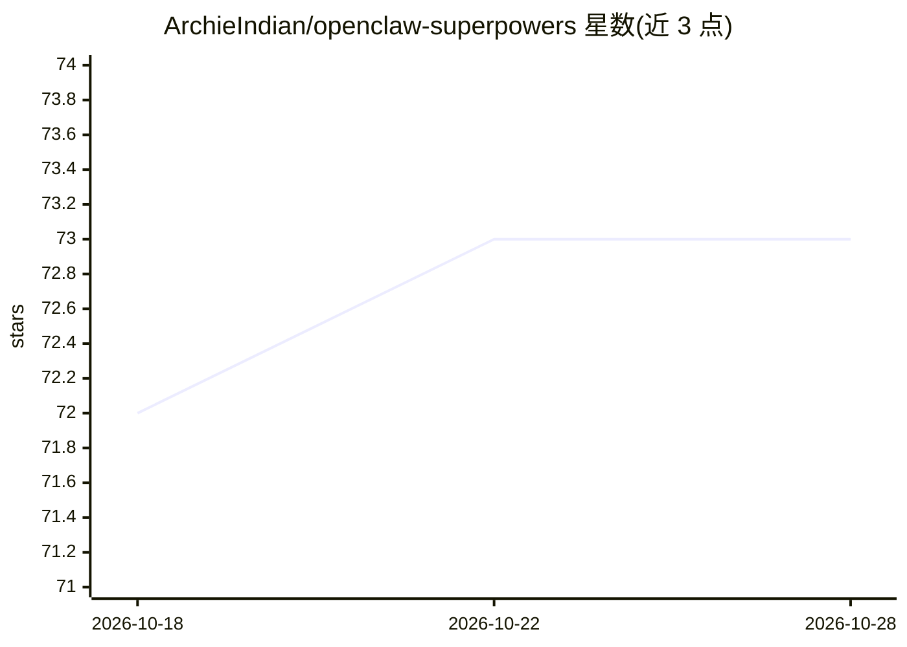

# ArchieIndian/openclaw-superpowers

⭐ 73 · Python · NOASSERTION · 推送 2026-05-03 · [GitHub](https://github.com/ArchieIndian/openclaw-superpowers) · 个人维护

**OpenClaw 代理的 56 个即插即用技能库：自治、自愈与自我改进**

面向 OpenClaw 持久运行 AI 代理的技能库，一条命令安装 56 个技能（核心 17 + OpenClaw 原生 38 + 社区 1）。提供结构化思维方法论、6 项安全防护（提示注入检测、危险动作确认门、安装前扫描）、16 个 cron 定时技能（记忆清理、健康检查、预算熔断）、基于 DAG 的记忆压缩与 SQLite 会话持久化。代理可在对话中通过 create-skill 编写新技能。README 明确说明安装不强制行为：技能靠模型自行决定是否调用。

## 筛选速览

| 维度 | 判定 | 备注 |
|---|---|---|
| AI 角色 | `ai-ecosystem` | LLM/agent 周边工具 |
| 许可风险 | `permissive` | NOASSERTION |
| 部署形态 | `None` |  |
| 模型依赖 | — | README 未给出锁定关系 |
| 硬件要求 | — | 无带数字的原话,不猜 |
| 安装摩擦 | `low` | 无编译、无系统依赖或容器化 |
| 成熟度 | — | 结构信号不足 |

## 能力要点

- 56 个技能覆盖思维方法论、安全防护、cron 调度与持久记忆
- create-skill 支持代理在对话中即时编写并生效新技能
- 6 项安全技能构成纵深防御层（注入检测、SHA-256 漂移检测、密钥扫描）
- DAG 记忆压缩与 SQLite FTS5 会话持久化支撑长期运行

## 适用场景

- 让 AI 代理 7×24 小时无人值守运行并从故障自恢复
- 为自治代理增加提示注入与危险动作防护
- 让代理在长期对话中保留关键记忆并按需召回

## 场景标签

`Agent 框架` `Agent 记忆` · 领域:Agent 开发

## 证据(README 行号)

> L11: A plug-and-play skill library for OpenClaw — the open-source AI agent runtime. Gives your agent structured thinking
> L13: Built for developers who want their AI agent to run autonomously 24/7, not just respond to prompts in a chat window

## 星数曲线

2026-10-18 72 → 2026-10-28 73（+1）

---
*卡片 v1 · prompt 1.4 · 生成 2026-10-24 · 置信度 high · 依据 README sha `4e9df572e6b6` · [字段定义](../../DATASET.md)*
