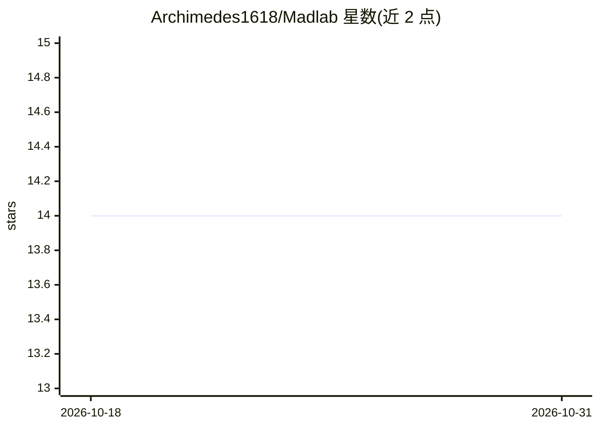

# Archimedes1618/Madlab

⭐ 14 · TypeScript · AGPL-3.0 · 推送 2026-02-08 · [GitHub](https://github.com/Archimedes1618/Madlab) · [官网](https://discord.gg/reBPqyhkdU) · 个人维护

**本地 LLM 微调工作室：导入数据集、训练、导出 GGUF**

自托管的 LLM 微调工具，覆盖数据集多格式导入与分析版本管理、LoRA/QLoRA/DoRA 训练（含 NEFTune、任务队列、断点续训）、GGUF 转换导出（f16/q8_0）与评估（BLEU/ROUGE、LLM Judge）。LLM 辅助功能（Magic Import、数据增强、超参建议）通过本地 LM Studio 实例提供。技术栈为 React 前端 + Node.js 后端 + Python (PyTorch/Transformers) 训练脚本，需分别手动安装运行；GPU 训练推荐 NVIDIA 8GB+ 显存，CUDA 可选，CPU 可运行但限小模型。

## 筛选速览

| 维度 | 判定 | 备注 |
|---|---|---|
| AI 角色 | `ai-ecosystem` | LLM/agent 周边工具 |
| 许可风险 | `viral` | AGPL-3.0 |
| 部署形态 | `library` | 以包/库形式分发 |
| 模型依赖 | local-ok | 支持本地模型 |
| 硬件要求 | — | 无带数字的原话,不猜 |
| 安装摩擦 | `medium` | 含编译或系统依赖之一 |
| 成熟度 | `idea` | |

## 能力要点

- LoRA/QLoRA/DoRA 微调，含 NEFTune 与训练任务队列
- 数据集多格式导入（CSV/Parquet/JSON/JSONL）与版本管理
- GGUF 转换导出（f16 或 q8_0 量化）
- 通过 LM Studio 提供 Magic Import、LLM Judge、合成数据生成

## 适用场景

- 在自己硬件上对 HuggingFace 模型做 LoRA/QLoRA 微调
- 导入整理数据集并跟踪版本后训练
- 训练后转换为 GGUF 用于本地部署

## 场景标签

`微调` `模型评测` · 领域:评测与运维

## 证据(README 行号)

> L8: Madlab is a self-hosted tool for fine-tuning language models on your own hardware. It handles the annoying parts: da
> L15: - **LoRA/QLoRA fine-tuning** with configurable rank, alpha, dropout

## 星数曲线

2026-10-18 14 → 2026-10-31 14（+0）

---
*卡片 v1 · prompt 1.4 · 生成 2026-10-31 · 置信度 mid · 依据 README sha `518a52902ab8` · [字段定义](../../DATASET.md)*
