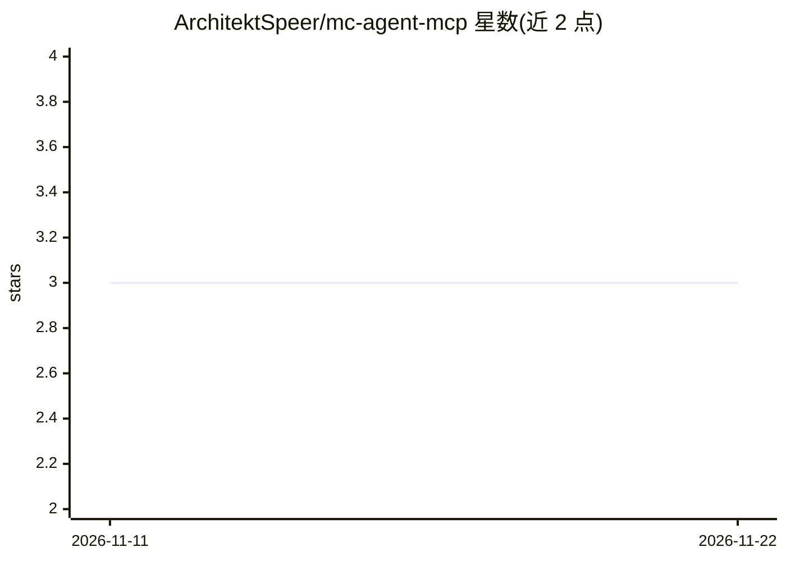

# ArchitektSpeer/mc-agent-mcp

⭐ 3 · Java · MIT · 推送 2026-10-17 · [GitHub](https://github.com/ArchitektSpeer/mc-agent-mcp) · 个人维护 · 中文 README

**在 Minecraft 内运行 MCP 服务器的 Fabric mod，让 AI agent 玩生存**

一个 client-side Fabric mod（Minecraft 1.21.11 / Java 21），在游戏客户端内启动 MCP Streamable HTTP 服务器（loopback + Bearer 认证），使 Claude、DeepSeek 等任意 MCP 客户端能够观察世界并操作玩家进行生存玩法。提供 29 个工具覆盖感知（ASCII 地图、实体/物品栏/配方读取）、移动、交互、合成与聊天；内置每 tick 的生存反射（自动防御、躲避苦力怕、进食、穿甲）弥补慢速模型的反应延迟；支持按类别权限、工具禁用与速率限制。

## 筛选速览

| 维度 | 判定 | 备注 |
|---|---|---|
| AI 角色 | `ai-ecosystem` | LLM/agent 周边工具 |
| 许可风险 | `permissive` | MIT |
| 部署形态 | `None` |  |
| 模型依赖 | — | README 未给出锁定关系 |
| 硬件要求 | — | 无带数字的原话,不猜 |
| 安装摩擦 | `medium` | 含编译或系统依赖之一 |
| 成熟度 | — | 结构信号不足 |

## 能力要点

- 29 个 MCP 工具覆盖感知、移动、交互、物品栏、合成与聊天
- 每 tick（50ms）生存反射：自动防御、躲避爬行者、进食、穿甲、脱困液体
- LLM 友好感知：ASCII 方块地图、RLE 编码、SSE 方块变更推送
- Owner 控制：loopback 限定、Bearer 认证、分类别权限与速率限制

## 适用场景

- 让 AI agent 在 Minecraft 生存模式中自主采集、合成、建造与战斗
- 通过 Claude Code / Cursor 等 MCP 客户端以自然语言指挥游戏操作
- 用 DeepSeek 或任意 OpenAI 兼容 API 驱动独立的 agent 循环脚本
- 以 watch-only 模式只读观察游戏世界而不让 agent 行动

## 场景标签

 · 领域:游戏/AI agent 接入

## 证据(README 行号)

> L5: A **Minecraft Fabric mod** that runs a **Model Context Protocol (MCP) server** inside the game
> L16: |Transport|MCP *Streamable HTTP* at `http://127.0.0.1:27890/mcp`, Bearer token|
> L22: - **29 tools** covering perception, movement, interaction, inventory, crafting and chat

## 星数曲线

2026-11-11 3 → 2026-11-22 3（+0）

---
*卡片 v1 · prompt 1.4 · 生成 2026-11-22 · 置信度 high · 依据 README sha `a9a96320ad68` · [字段定义](../../DATASET.md)*
